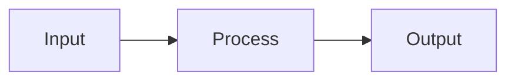

# no-ascii-art-diagrams

Forbid diagrams drawn with box characters in markdown code blocks; prefer Mermaid.

## Rule Details

A diagram drawn in box characters is hard to edit, unreadable to a screen reader, and breaks at any width or font other than the author's. A Mermaid diagram is source a reader can change and a renderer can lay out. The rule reports a fenced code block whose lines draw a box: at least three lines carrying two or more box characters (`┌ ┐ └ ┘ │ ─ ├ ┤ ┬ ┴ ┼`, their double-line forms, `+` and `|`), with an opening corner, a right-hand border character, and at least two lines with a vertical border. The rule does not fix.

A directory tree drawn with `├──` and `└──` is not a box and is left alone, as are markdown tables outside code blocks. In a file named `README.md` the message points at a separate architecture document instead, since npm does not render Mermaid.

## Options

This rule has no options.

## Examples

### ❌ Incorrect

````markdown
The pipeline:

```
┌──────────────────────────────────────┐
│               PIPELINE               │
├──────────────────────────────────────┤
│  Input ──▶ │ Process │ ──▶ │ Output  │
└──────────────────────────────────────┘
```
````

### ✅ Correct

````markdown
The pipeline:


````

### ✅ Correct, a directory tree

````markdown
The project layout:

```
src/
├── index.ts
├── utils/
│   └── helper.ts
└── types.ts
```
````

## Limitations

Only fences of backticks are read; a block fenced with tildes is not checked.
