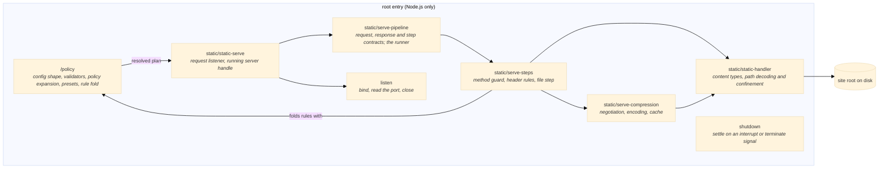
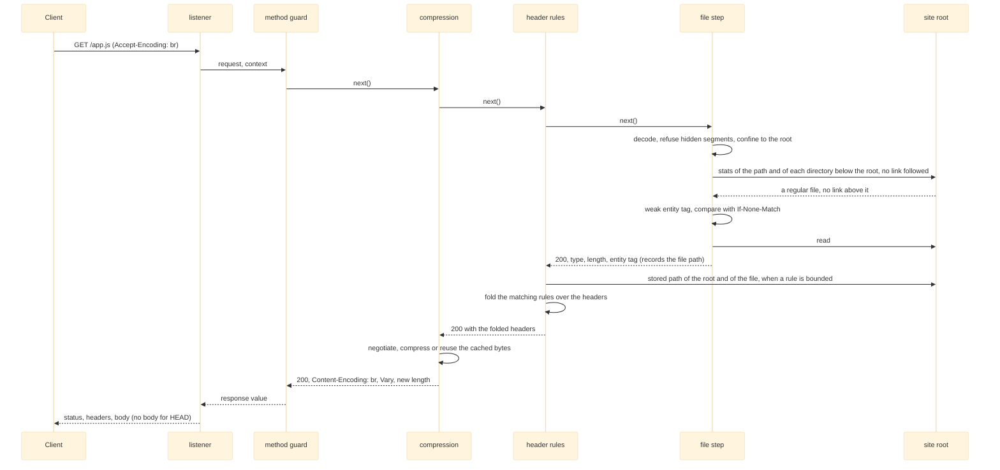

# Architecture

How [`@hyperfrontend/server`](https://www.hyperfrontend.dev/docs/libraries/server/) answers a request: a listener runs an ordered list of steps, each step returns a complete response value, and the serving plan the steps read is plain data. For installation and a first server, see the [README](./README.md).

## System Overview



The package has two entries. The root entry is the Node.js HTTP kernel: the listener helpers, the wait for a shutdown signal, the step pipeline and the static file serving built on it. The [`/policy`](https://www.hyperfrontend.dev/docs/libraries/server/policy/) entry is the serving policy as data: the authoring shape of a serve config, the validators that turn an unknown value into one, the expansion of the declared policy fields into header rules, the presets that write common rules, and the fold that applies ordered rules to one path. It imports no Node.js built-in, and the root entry does not re-export it. The root entry imports one value from it, the fold, so a tool that reads a config and the server that sends it run the same code.

The root entry holds two ways to serve files. They share the path helpers and nothing else:

| Path                | Built by                                                                                                                                                                                                 | What it adds over reading the file                                                                                                           |
| ------------------- | -------------------------------------------------------------------------------------------------------------------------------------------------------------------------------------------------------- | -------------------------------------------------------------------------------------------------------------------------------------------- |
| Single-root handler | [`createStaticHandler`](https://www.hyperfrontend.dev/docs/libraries/server/#api-createStaticHandler), [`serveFile`](https://www.hyperfrontend.dev/docs/libraries/server/#api-serveFile)                 | Root confinement, the refusal of symlinks, a content type, the directory index and its redirect. It writes straight to the Node.js response. |
| Step pipeline       | [`createServeListener`](https://www.hyperfrontend.dev/docs/libraries/server/#api-createServeListener), [`startStaticServer`](https://www.hyperfrontend.dev/docs/libraries/server/#api-startStaticServer) | All of the above, plus the method guard, compression, header rules, conditional requests and hidden files                                    |

### What the kernel leaves out

Each of these is absent on purpose, and a caller that needs one supplies it outside the package.

- **Routing and request bodies.** A step sees the method, the URL and the headers. The built-in guard answers every method other than GET and HEAD with 405.
- **Asynchronous steps and streaming.** A step returns its response synchronously, and a file is read whole before it is answered. There are no range requests.
- **Finding and loading a config file.** The pipeline takes a plan that is already resolved: an absolute root, a concrete port, the header rules in their final order. Reading a file, applying defaults and expanding the policy fields into rules are the caller's; [`expandHeaderPolicy`](https://www.hyperfrontend.dev/docs/libraries/server/policy/#api-expandHeaderPolicy) does the last of these.
- **Security headers by default.** No header is sent that the plan does not carry. Who may frame a page is a field the caller declares, and a plan without it leaves every path framable.
- **Caching headers.** The file step sets a weak entity tag and nothing else. A cache lifetime is a header rule the plan carries.
- **Directory listings and fallback pages.** A path with no file behind it answers 404.
- **TLS.** The default server is Node's plain HTTP one, and the handle reports an `http://` origin. The server factory is injectable, which is how a spec substitutes a server of its own.

## Design Principles

1. **A response is a value until the listener writes it.** A step returns a status, a header record and a body, and may transform what the rest of the pipeline returned. Only the listener touches the socket, which is what lets a step be tested without one and lets the listener answer 500 when a step throws.

   ```ts
   import type { ServeStep } from '@hyperfrontend/server'

   // ✅ delegate inward, then return a new value
   const stamp: ServeStep = (request, context, next) => {
     const response = next()
     return { ...response, headers: { ...response.headers, 'X-Served-By': 'kernel' } }
   }
   // ❌ a step that mutates what it was handed, where every field is read-only
   const mutate: ServeStep = (request, context, next) => {
     const response = next()
     Object.assign(response.headers, { 'X-Served-By': 'kernel' })
     return response
   }
   ```

2. **Order is behaviour.** The built-in order is method guard, compression, header rules, file. Header rules sit inside compression so that a rule shapes what the compressor sees: a rule that sets `Cache-Control: no-transform` switches encoding off, and a rule that sets the content type decides whether a body is compressible. Custom steps are prepended, so they see every request first and every response last.

   ```ts
   import type { ServeStep } from '@hyperfrontend/server'
   import type { ResolvedServeConfig } from '@hyperfrontend/server/policy'
   import { buildServeSteps, createServeListener } from '@hyperfrontend/server'

   declare const config: ResolvedServeConfig
   declare const stamp: ServeStep

   // ✅ custom steps go in front of the built-ins
   const listener = createServeListener(config, { steps: [stamp] })
   // ❌ rules moved outside compression can no longer switch it off
   const [guard, compression, rules, file] = buildServeSteps(config)
   const reordered = [guard, rules, compression, file]
   ```

3. **Policy is data, and its entry loads no Node.js built-in.** A serve config is an object that a build step, a test or a browser bundle can author and validate. Nothing in the [`/policy`](https://www.hyperfrontend.dev/docs/libraries/server/policy/) entry reaches `node:http`, `node:fs` or `node:zlib`, directly or through an import.

   ```ts
   import { defineServeConfig, validateServeConfig } from '@hyperfrontend/server/policy'

   // ✅ authored and validated without the HTTP stack
   const config = defineServeConfig({ root: 'dist/site', isolation: 'require-corp' })
   validateServeConfig(config, 'serve.config.json')
   ```

4. **The root confines every path, and what is hidden answers 404.** A request path is percent-decoded once, stripped of leading separators of either kind, resolved against the normalised root and accepted only when the result is the root or sits under it. The confinement compares path text and resolves no link, so links are refused separately: no symlink at or below the root is followed. A file is served only when it is a regular file and no directory between it and the root is a link, each tested without following it; a request that names a symlink, or whose path passes through a symlinked directory, answers 404 wherever the link points, inside the root or outside it. The root itself is never tested, so a root that is a symlink, as a deploy directory often is, serves as usual. Each segment is asked whether it is a link and no real path is compared, so a spelling that differs from the one on disk only by letter case or by a Windows short name is not mistaken for a link. Dotfiles and any file named `hf-serve.config.*` are never served.

   ```ts
   import { join } from 'node:path'
   import { confineDecodedPath } from '@hyperfrontend/server'

   // ✅ null for a path that escapes, which the file step answers with 403
   const confined = confineDecodedPath('/srv/site', '/../etc/passwd')
   // ❌ the raw URL joined onto the root
   const unsafe = join('/srv/site', '/../etc/passwd')
   ```

5. **Every boundary is injectable.** File reads, file tests, stats, the lookup of a stored path, server creation and the log sink each have a production default and an override, so the whole pipeline runs against values in a spec, with no disk and no port. The stored-path lookup is the one default that is asked about an injected site: it answers nothing for a path the disk does not hold, and the rules are then matched against the path as resolved.

   ```ts
   import type { ServeStepDeps } from '@hyperfrontend/server'
   import type { ResolvedServeConfig } from '@hyperfrontend/server/policy'
   import { createServeListener } from '@hyperfrontend/server'

   declare const config: ResolvedServeConfig
   declare const site: Map<string, Buffer>
   declare const stats: Map<string, ReturnType<NonNullable<ServeStepDeps['stat']>>>

   // ✅ the pipeline over an in-memory site
   const listener = createServeListener(config, {
     isFile: (filePath) => site.has(filePath),
     readFile: (filePath) => site.get(filePath) ?? Buffer.alloc(0),
     stat: (filePath) => stats.get(filePath) ?? null,
     realPath: () => null,
   })
   ```

6. **The pipeline owns the headers that describe the body.** `Content-Length`, `Content-Encoding` and the entity tag are computed from the bytes on the wire. A header rule that names one of them is skipped, in any letter case, so a plan cannot make the headers disagree with the body.

7. **A declared intent cannot be undone by accident.** The fold replaces a header's whole value, so a later `Content-Security-Policy` rule would silently drop the `frame-ancestors` directive that the embedders field expanded into. The validators refuse that rule when the config loads instead of appending the directive to it: what a rule writes stays exactly what is sent.

   ```ts
   import { expandHeaderPolicy } from '@hyperfrontend/server/policy'

   // ✅ a bounded rule restates who may frame the paths it matches
   expandHeaderPolicy({
     embedders: ['https://host.example'],
     headers: [{ prefix: '/admin/', headers: { 'Content-Security-Policy': "default-src 'self'; frame-ancestors 'none'" } }],
   })
   // ❌ throws: the rule replaces the policy and names no frame-ancestors
   expandHeaderPolicy({
     embedders: ['https://host.example'],
     headers: [{ suffix: '.html', headers: { 'Content-Security-Policy': "default-src 'self'" } }],
   })
   ```

8. **A config reports all of its problems, and the first is stable.** The collecting check runs the checks in a fixed order and returns every problem with a code, a path and a sentence. The throwing validators print one line per problem, so the first line of an error is always the first problem in that order, and a tool can print the same sentences without parsing an error.

   ```ts
   import { checkServeConfig } from '@hyperfrontend/server/policy'

   // ✅ every problem at once, in a fixed order
   checkServeConfig({ port: 0, embedders: ['host.example'] }).map((issue) => issue.code)
   // ['port-invalid', 'embedder-scheme-missing']
   // ❌ fixing a config one thrown error at a time
   ```

## Module Composition

| Module                              | Entry                                                                    | Responsibility                                                                                                                                                      |
| ----------------------------------- | ------------------------------------------------------------------------ | ------------------------------------------------------------------------------------------------------------------------------------------------------------------- |
| `listen.ts`                         | root                                                                     | Starts a server and resolves with the bound port, rejects with the bind error, reads the port of a listening server, closes a server                                |
| `shutdown.ts`                       | root                                                                     | A promise that settles on an interrupt or terminate signal                                                                                                          |
| `static/serve-pipeline.ts`          | root                                                                     | The request, response, context and step contracts; the runner; the plain-text response; the case-insensitive header read                                            |
| `static/serve-steps.ts`             | root                                                                     | The method guard, the header-rules step that calls the policy entry's fold, the file step, the order the three take around compression, and the answer to a failure |
| `static/served-path.ts`             | root                                                                     | The lookup of the path a file system stores a path under, and the root-relative path of a served file that header rules are matched against                         |
| `static/serve-compression.ts`       | root                                                                     | Encoding negotiation and the compression step with its cache                                                                                                        |
| `static/static-handler.ts`          | root                                                                     | The content-type table, request-path parsing and decoding, root confinement, the directory redirect location, and the single-root handler                           |
| `static/static-serve.ts`            | root                                                                     | The listener that runs the pipeline and writes its response, and the server handle with its origin URL and teardown                                                 |
| `policy/serve-types.ts`             | [`/policy`](https://www.hyperfrontend.dev/docs/libraries/server/policy/) | The authoring shape of a serve config, of one header rule and of a preset's scope, the header policy subset, and the identity helper that types a config            |
| `policy/serve-config.ts`            | [`/policy`](https://www.hyperfrontend.dev/docs/libraries/server/policy/) | The resolved plan the pipeline reads, the check that collects every problem of a config, the validators that throw them, and the isolation expansion                |
| `policy/issues.ts`                  | [`/policy`](https://www.hyperfrontend.dev/docs/libraries/server/policy/) | The shape and the codes of a reported problem, and the helper that turns problems into one error                                                                    |
| `policy/source.ts`                  | [`/policy`](https://www.hyperfrontend.dev/docs/libraries/server/policy/) | The host-source grammar the two policy fields share, and the test for a source that permits every origin                                                            |
| `policy/embedders.ts`               | [`/policy`](https://www.hyperfrontend.dev/docs/libraries/server/policy/) | The embedders check, the `frame-ancestors` writer, and the rule the field expands into                                                                              |
| `policy/permissions-policy.ts`      | [`/policy`](https://www.hyperfrontend.dev/docs/libraries/server/policy/) | The permissions-policy check and the rule the field expands into                                                                                                    |
| `policy/content-security-policy.ts` | [`/policy`](https://www.hyperfrontend.dev/docs/libraries/server/policy/) | The whole-policy preset, and the reader of the `frame-ancestors` lists a header value declares                                                                      |
| `policy/presets.ts`                 | [`/policy`](https://www.hyperfrontend.dev/docs/libraries/server/policy/) | The single-header presets: content type options, referrer policy, transport security, immutable assets, scoped isolation                                            |
| `policy/scope.ts`                   | [`/policy`](https://www.hyperfrontend.dev/docs/libraries/server/policy/) | The check of a preset's scope, the builder of a rule bounded by one, and the test for bounds that exclude no path                                                   |
| `policy/interplay.ts`               | [`/policy`](https://www.hyperfrontend.dev/docs/libraries/server/policy/) | The check of the two policy fields, and of authored rules that drop or contradict the declared embedders                                                            |
| `policy/expand.ts`                  | [`/policy`](https://www.hyperfrontend.dev/docs/libraries/server/policy/) | The expansion of the policy fields into ordered rules, and the fold of ordered rules over one path's headers                                                        |

The static directory is not an entry of its own: the root entry owns it and exports its public names. Within the policy entry, the modules that check a field do not import the config validators, so the validators and the expansion can both build on them without a cycle.

## Data Flow

A GET for a script, from a client that accepts brotli, through the listener that [`startStaticServer`](https://www.hyperfrontend.dev/docs/libraries/server/#api-startStaticServer) installs:



### The file step

The file step is terminal: it never calls the rest of the pipeline. Its answers, in the order they are decided:

| Condition                                                                                                    | Answer                                              |
| ------------------------------------------------------------------------------------------------------------ | --------------------------------------------------- |
| The path carries a malformed percent-encoding                                                                | 400                                                 |
| A segment is a dotfile or names the config file                                                              | 404                                                 |
| The decoded path resolves outside the root                                                                   | 403                                                 |
| The path has no trailing slash and names a directory with an `index.html`, reached through no symlink        | 301 to the slashed form, query string kept          |
| The path is not a regular file (missing, a directory, or a symlink), or passes through a symlinked directory | 404                                                 |
| `If-None-Match` matches the entity tag under weak comparison                                                 | 304 with the entity tag and no body                 |
| Otherwise                                                                                                    | 200 with the content type, length, entity tag, body |

A URL ending in a slash resolves to that directory's `index.html`. The entity tag is weak and derived from the file's size and modification time, so it changes when a deployment replaces the file and costs no read. The redirect location is rebuilt from the resolved path, one encoded segment at a time, so a request that writes an authority into its URL is never answered with a location off this origin.

### The header rule fold

The header-rules step lets the file step answer first, then folds the plan's rules over the response headers in order. The fold itself is [`applyHeaderRules`](https://www.hyperfrontend.dev/docs/libraries/server/policy/#api-applyHeaderRules) in the policy entry, which takes rules, a path and the headers a response already carries; the step only chooses the path.

1. A rule matches when the path starts with its prefix and ends with its suffix; a bound that is absent matches everything. The path is the served file's path relative to the root when the request reached a file, so a suffix of `.html` covers a directory URL, and the request path otherwise.
2. Each header of a matching rule replaces the header of the same name, compared without regard to case, so a later rule overrides an earlier one a header at a time and no header is ever present under two spellings. A header keeps the position it first took.
3. A rule's `Content-Length`, `Content-Encoding` or entity tag header is skipped.

A header policy follows the file that is served, not the spelling that reached it. On a file system that ignores letter case, `/HOST/index.html` reaches `host/index.html`, and a Windows short name or another Unicode normalisation reaches a file the same way. So when a file is about to be served and the plan bounds at least one rule, the step looks up the stored path of the root and of the file, every link resolved and every name as its directory lists it, and matches the rules against the file's path below the stored root. Both lookups are made per request, so a root that is a link can be pointed at a new release while the server runs. For the rules, nothing is looked up for a plan whose rules all match every path, or for an answer that serves no file.

The lookup never turns a served file into a 404. When it has no answer, or the stored file does not sit below the stored root, the rules are matched against the path as resolved from the request. That is the stored path wherever the file system tells spellings apart, because no link below the root is followed. The bounds themselves are compared letter for letter, so a rule is written the way the directory lists the name.

The method guard answers before the header-rules step is reached, so it folds the same rules over its own 405, matched against the request path. Every answer of the built-in steps therefore carries the plan's headers; what a custom step answers by itself does not.

### The policy expansion

A declared policy field is not a separate mechanism. [`expandHeaderPolicy`](https://www.hyperfrontend.dev/docs/libraries/server/policy/#api-expandHeaderPolicy) turns each into one rule that matches every path, and places them ahead of the authored rules so that an authored rule still overrides any header they set:

| Order | Source                                                                                                                    | Rule                                                                                                                                        |
| ----- | ------------------------------------------------------------------------------------------------------------------------- | ------------------------------------------------------------------------------------------------------------------------------------------- |
| 1     | [`embedders`](https://www.hyperfrontend.dev/docs/libraries/server/policy/#api-ServeConfig-prop-embedders)                 | `Content-Security-Policy: frame-ancestors` with the sources as written, and `X-Frame-Options` for an empty list, `'none'` or `'self'` alone |
| 2     | [`permissionsPolicy`](https://www.hyperfrontend.dev/docs/libraries/server/policy/#api-ServeConfig-prop-permissionsPolicy) | `Permissions-Policy` with the features as written; no rule for an empty record                                                              |
| 3     | [`isolation`](https://www.hyperfrontend.dev/docs/libraries/server/policy/#api-ServeConfig-prop-isolation)                 | The opener, embedder and resource policies                                                                                                  |
| 4     | [`headers`](https://www.hyperfrontend.dev/docs/libraries/server/policy/#api-ServeConfig-prop-headers)                     | The authored rules, unchanged                                                                                                               |

Because the fold replaces whole values and `frame-ancestors` has no fallback directive, the expansion and the validators both judge every authored rule that sets `Content-Security-Policy` once embedders are declared. A value in which no comma-separated policy names the directive is refused for any rule. A rule that matches every path is also refused unless each of its lists equals the declared one token for token, since it would otherwise replace the declared list everywhere. A bounded rule with a list of its own is how one area of a site gets a different answer, and the report-only header is never judged.

Both judgements read a rule the way a browser and the fold do. A directive holding any character other than ASCII whitespace and visible ASCII is discarded whole by a browser, so [`frameAncestorsOf`](https://www.hyperfrontend.dev/docs/libraries/server/policy/#api-frameAncestorsOf) reads it as absent. A prefix that is empty or `/` and a suffix that is empty exclude no path, so [`matchesEveryPath`](https://www.hyperfrontend.dev/docs/libraries/server/policy/#api-matchesEveryPath) reads a rule carrying only those as a rule for every path. [`expandHeaderPolicy`](https://www.hyperfrontend.dev/docs/libraries/server/policy/#api-expandHeaderPolicy) runs the config validator over the four fields it reads, so a caller that never validated gets the same refusals and no rule built from unchecked input.

A source is checked against a grammar narrower than the one browsers accept: a scheme, a host of lowercase labels with an optional leading `*.` over at least two of them, and an optional port. Anything that would permit every origin, carry a path or depend on the page's own scheme is refused, and no message repeats the entry it is about. The [policy entry's page](./src/policy/README.md) lists each refusal.

### Compression

The compression step encodes a response only when all of these hold: the status is 200, there is a body of at least 1024 bytes, the content type is text, JavaScript, JSON, SVG or XML, no rule set `Cache-Control: no-transform`, and the client accepts brotli or gzip. Brotli is preferred and runs at quality 4. Compressed bytes are cached per file and encoding and reused while the entity tag is unchanged, so a static deployment compresses each asset once per encoding. An entry is keyed by the file's path below the root as the file system stores it. A path that misses under the spelling it was resolved by is looked up under its stored spelling before anything is compressed, so the many spellings a volume that ignores letter case accepts for one file share one entry and cannot grow the cache. `Content-Length` is rewritten to the encoded size.

A 200 of a compressible type carries `Vary: Accept-Encoding` whether or not it was encoded, so a body under the threshold and a client that accepts neither encoding are marked too, and so are a HEAD and a 304 for such a file. The value is merged into whatever a rule already put there. A HEAD is never encoded and keeps the identity length. A response that a rule marked `no-transform` is returned untouched.

### Failure

A step that throws is answered with 500 and one line on the log sink. The 500 carries the header rules that match the request path, then `Cache-Control: no-store` whatever a rule set, so a fault is never cached under a lifetime written for the file. A response Node.js refuses to write, such as one whose header bytes are illegal, is logged and answered with the same 500 once the headers already set are removed, so the failure never goes out under a file's length or entity tag. When the rule headers are themselves what Node.js refuses, which a validated config rules out, the 500 is sent with no header at all. No single request takes the server down. A request Node.js cannot parse never reaches the listener: Node.js answers it itself with a bare 400, 408 or 431, which carries none of the plan's headers. [`listen`](https://www.hyperfrontend.dev/docs/libraries/server/#api-listen) rejects with the bind error instead of letting a refused port become an uncaught exception, and removes its error listener once the port is bound.

## Core Interfaces

```ts
import type { IncomingHttpHeaders } from 'node:http'
import type { PolicyIssueCode, ServeConfig } from '@hyperfrontend/server/policy'

interface StaticRequest {
  readonly method: string
  readonly url: string
  readonly headers: IncomingHttpHeaders
}

interface StaticResponse {
  readonly status: number
  readonly headers: Readonly<Record<string, string>>
  readonly body: Buffer | null
}

interface ServeStepContext {
  readonly config: ResolvedServeConfig
  filePath?: string
}

type ServeStep = (request: StaticRequest, context: ServeStepContext, next: () => StaticResponse) => StaticResponse

interface ResolvedServeConfig {
  readonly root: string
  readonly port: number
  readonly host?: string
  readonly headers: readonly ServeHeaderRule[]
  readonly log: boolean
  readonly sourcePath?: string
}

interface ServeHeaderRule {
  prefix?: string
  suffix?: string
  headers: Record<string, string>
}

type HeaderPolicy = Pick<ServeConfig, 'embedders' | 'permissionsPolicy' | 'isolation' | 'headers'>

interface PolicyIssue {
  readonly code: PolicyIssueCode
  readonly path: string
  readonly message: string
}

interface StaticServerHandle {
  readonly port: number
  readonly url: string
  close(): Promise<void>
}
```

The step and server contracts are exported from the root entry; [`ResolvedServeConfig`](https://www.hyperfrontend.dev/docs/libraries/server/policy/#api-ResolvedServeConfig), [`ServeConfig`](https://www.hyperfrontend.dev/docs/libraries/server/policy/#api-ServeConfig), [`ServeHeaderRule`](https://www.hyperfrontend.dev/docs/libraries/server/policy/#api-ServeHeaderRule), [`HeaderPolicy`](https://www.hyperfrontend.dev/docs/libraries/server/policy/#api-HeaderPolicy) and [`PolicyIssue`](https://www.hyperfrontend.dev/docs/libraries/server/policy/#api-PolicyIssue) from the [`/policy`](https://www.hyperfrontend.dev/docs/libraries/server/policy/) entry. The context's file path is the one field a step writes: the file step records what it resolved, and the header-rules and compression steps read it.

## Links

- [README](./README.md): what the package is for, installation and a first server.
- [policy](./src/policy/README.md): the entry that describes a serve config as data.
