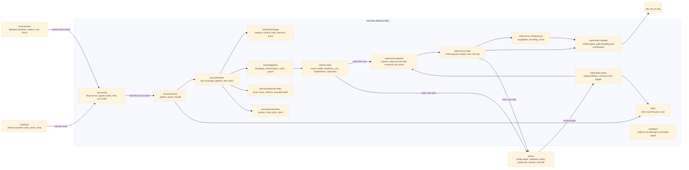
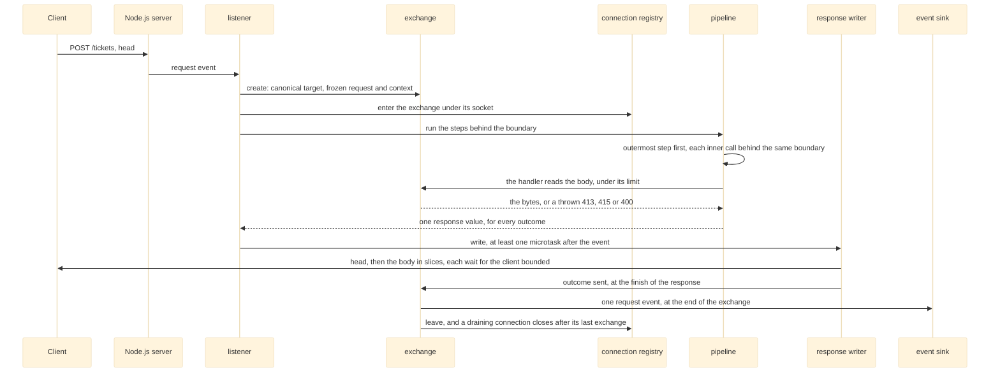
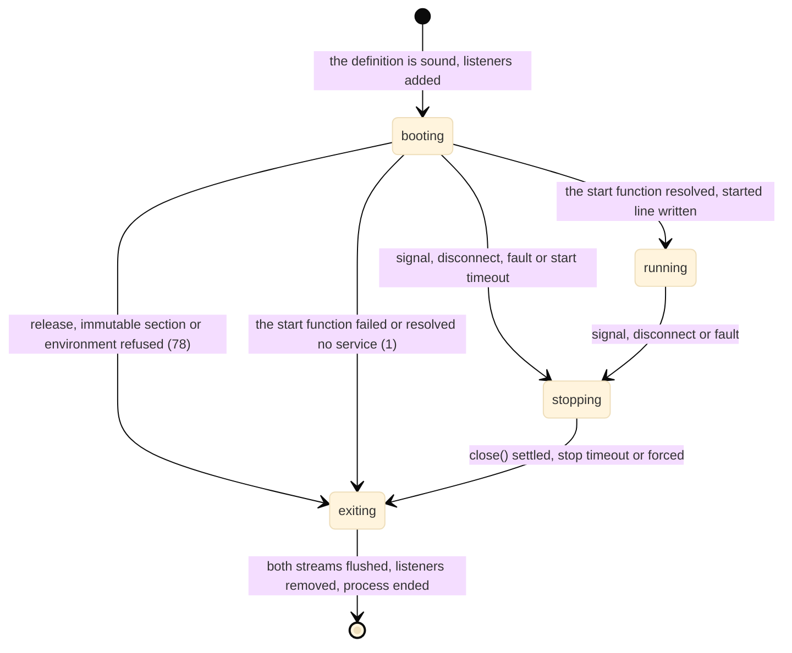
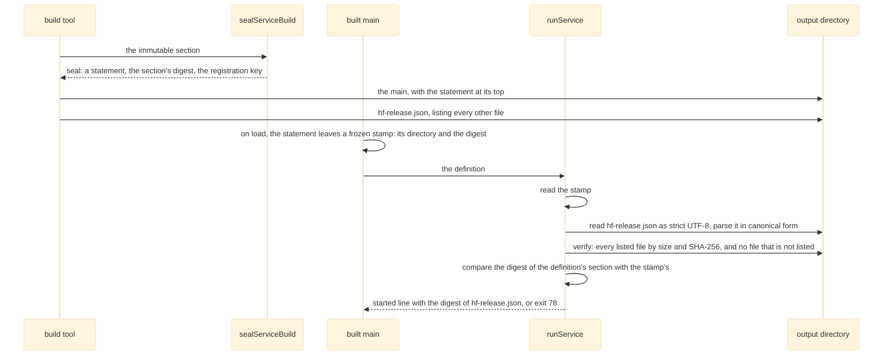
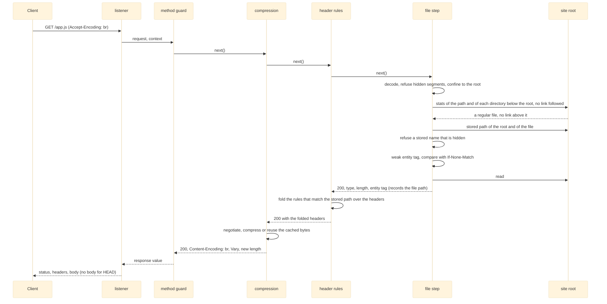

# Architecture

How [`@hyperfrontend/server`](https://www.hyperfrontend.dev/docs/libraries/server/) answers a request and runs a process. A listener runs an ordered list of steps and writes the one response value they produce; that holds for both of its contracts, the synchronous one that serves files and the asynchronous one that serves everything else. Around them sit a runner, the one place with process effects, and two entries of plain data: the serving policy and the environment a service reads. For installation and a first service, see the [README](./README.md).

## System Overview



The package has four entries:

| Entry                                                                              | Holds                                                                                                                                                                                                             | Node.js built-ins                 |
| ---------------------------------------------------------------------------------- | ----------------------------------------------------------------------------------------------------------------------------------------------------------------------------------------------------------------- | --------------------------------- |
| root                                                                               | Both request contracts, the runner, the listener helpers and the wait for a shutdown signal                                                                                                                       | Yes                               |
| [`/environment`](https://www.hyperfrontend.dev/docs/libraries/server/environment/) | The declaration of the environment a service reads, the readers that turn a variable's text into a typed value, and the check that reports every problem without a value                                          | None; it never reads the process  |
| [`/manifest`](https://www.hyperfrontend.dev/docs/libraries/server/manifest/)       | The release manifest `hf-release.json`: its format and validator, the writer that indexes a directory and the verification of a directory against it                                                              | Yes: the file system and the hash |
| [`/policy`](https://www.hyperfrontend.dev/docs/libraries/server/policy/)           | The serving policy as data: the authoring shape of a serve config, its validators, the expansion of the declared policy fields into header rules, the presets and the fold that applies ordered rules to one path | None                              |

No entry re-exports another. The root entry imports values from two of them, by relative path, so that a tool and the server run the same code: the fold and the rule validator from the policy entry, for the header-rules steps of both contracts, and the parser, the verification and the digest from the manifest entry, for the runner's release check. From the environment entry it takes types only.

The root entry holds three ways to answer a request. The two static ones share the path helpers; the service mounts the static pipeline whole, as one step:

| Path                | Built by                                                                                                                                                                                                 | What it adds over reading the file                                                                                                                                                                                                                                                                             |
| ------------------- | -------------------------------------------------------------------------------------------------------------------------------------------------------------------------------------------------------- | -------------------------------------------------------------------------------------------------------------------------------------------------------------------------------------------------------------------------------------------------------------------------------------------------------------- |
| Single-root handler | [`createStaticHandler`](https://www.hyperfrontend.dev/docs/libraries/server/#api-createStaticHandler), [`serveFile`](https://www.hyperfrontend.dev/docs/libraries/server/#api-serveFile)                 | Root confinement, the refusal of symlinks, a content type, the directory index and its redirect. It writes straight to the Node.js response.                                                                                                                                                                   |
| Step pipeline       | [`createServeListener`](https://www.hyperfrontend.dev/docs/libraries/server/#api-createServeListener), [`startStaticServer`](https://www.hyperfrontend.dev/docs/libraries/server/#api-startStaticServer) | All of the above, plus the method guard, compression, header rules, conditional requests and hidden files                                                                                                                                                                                                      |
| Service             | [`startService`](https://www.hyperfrontend.dev/docs/libraries/server/#api-startService), [`runService`](https://www.hyperfrontend.dev/docs/libraries/server/#api-runService)                             | Asynchronous steps, a canonical request target, request bodies under a limit, streamed responses, a router, events, and a drain that lets requests in flight finish. The step pipeline above is one of its steps through [`staticFiles`](https://www.hyperfrontend.dev/docs/libraries/server/#api-staticFiles) |

### What each contract leaves out

Each of these is absent on purpose, and a caller that needs one supplies it outside the package.

The static pipeline:

- **Routing and request bodies.** A static step sees the method, the URL and the headers. The built-in guard answers every method other than GET and HEAD with 405. Both belong to the service contract.
- **Asynchronous steps and streaming.** A static step returns its response synchronously, and a file is read whole before it is answered. There are no range requests.
- **Finding and loading a config file.** The pipeline takes a plan that is already resolved: an absolute root, a concrete port, the header rules in their final order. Reading a file, applying defaults and expanding the policy fields into rules are the caller's; [`expandHeaderPolicy`](https://www.hyperfrontend.dev/docs/libraries/server/policy/#api-expandHeaderPolicy) does the last of these.
- **Security headers by default.** No header is sent that the plan does not carry. Who may frame a page is a field the caller declares, and a plan without it leaves every path framable.
- **Caching headers.** The file step sets a weak entity tag and nothing else. A cache lifetime is a header rule the plan carries.
- **Directory listings and fallback pages.** A path with no file behind it answers 404.
- **TLS.** The default server is Node's plain HTTP one, and the handle reports an `http://` origin. The server factory is injectable, which is how a spec substitutes a server of its own.
- **A defence against a writer of the served directory.** No symlink below the root is followed, but a hard link is a file like any other and is served. A writer who can swap a directory for a link between the check and the read is outside what a path check can stop, so the served directory is writable by the deployment alone.

The service contract:

- **TLS.** The service speaks plain HTTP/1.1. The server factory is a seam for specs: the connection registry tracks the sockets of a plain server, so a TLS server handed in answers requests but is cut, not drained, when the service closes.
- **A cap on connections, on pipelined requests or on one route's whole request.** The time to receive a request is one server-wide bound that counts from the start of the request, so one long upload raises it for every route, and up to it a slow client holds a connection and a pending body read. Nothing counts connections or the requests one connection pipelines: a proxy in front caps them.
- **A deadline for every handler.** A handler is bounded only when its route sets one, and the source of a stream body is never bounded. A handler that never settles holds its exchange until the client leaves or the shutdown grace runs out.
- **A way to stop a handler.** Cancellation is cooperative: a deadline, a client that left and the shutdown grace abort a signal. A handler that ignores it keeps running after its response is gone, and nothing counts such handlers.
- **Compression of routed and streamed responses.** Header rules reach them as headers only.
- **Normalising a target.** What would need normalising is refused with 400.
- **An answer to a preflight no step declared.** The router synthesises no OPTIONS route; [`cors`](https://www.hyperfrontend.dev/docs/libraries/server/#api-cors) answers preflights.
- **A logger.** The service writes to no stream. Events go to a sink the caller passes, and without one the service is silent.

The runner:

- **More signals than a supervisor or a terminal sends to stop a service.** A hangup signal is left to the default of Node.js, so a service in a terminal that closes dies by it.
- **A way for a service to ask for its own stop.** A service ends through a signal, a closed IPC channel or a fault.
- **Reading anything of a build but its release manifest.** The immutable section is in the code; only its digest is compared.

## Design Principles

1. **A response is a value until the listener writes it.** A step returns a status, a header record and a body, and may transform what the rest of the pipeline returned. Only the listener touches the socket, which is what lets a step be tested without one and lets the listener answer 500 when a step throws.

   ```ts
   import type { ServeStep } from '@hyperfrontend/server'

   // ✅ delegate inward, then return a new value
   const stamp: ServeStep = (request, context, next) => {
     const response = next()
     return { ...response, headers: { ...response.headers, 'X-Served-By': 'kernel' } }
   }
   // ❌ a step that mutates what it was handed, where every field is read-only
   const mutate: ServeStep = (request, context, next) => {
     const response = next()
     Object.assign(response.headers, { 'X-Served-By': 'kernel' })
     return response
   }
   ```

2. **Order is behaviour.** The built-in order is method guard, compression, header rules, file. Header rules sit inside compression so that a rule shapes what the compressor sees: a rule that sets `Cache-Control: no-transform` switches encoding off, and a rule that sets the content type decides whether a body is compressible. Custom steps are prepended, so they see every request first and every response last.

   ```ts
   import type { ServeStep } from '@hyperfrontend/server'
   import type { ResolvedServeConfig } from '@hyperfrontend/server/policy'
   import { buildServeSteps, createServeListener } from '@hyperfrontend/server'

   declare const config: ResolvedServeConfig
   declare const stamp: ServeStep

   // ✅ custom steps go in front of the built-ins
   const listener = createServeListener(config, { steps: [stamp] })
   // ❌ rules moved outside compression can no longer switch it off
   const [guard, compression, rules, file] = buildServeSteps(config)
   const reordered = [guard, rules, compression, file]
   ```

3. **Policy is data, and its entry loads no Node.js built-in.** A serve config is an object that a build step, a test or a browser bundle can author and validate. Nothing in the [`/policy`](https://www.hyperfrontend.dev/docs/libraries/server/policy/) entry reaches `node:http`, `node:fs` or `node:zlib`, directly or through an import.

   ```ts
   import { defineServeConfig, validateServeConfig } from '@hyperfrontend/server/policy'

   // ✅ authored and validated without the HTTP stack
   const config = defineServeConfig({ root: 'dist/site', isolation: 'require-corp' })
   validateServeConfig(config, 'serve.config.json')
   ```

4. **The root confines every path, and what is hidden answers 404.** A request path is percent-decoded once, stripped of leading separators of either kind, resolved against the normalised root and accepted only when the result is the root or sits under it. The confinement compares path text and resolves no link, so links are refused separately: no symlink at or below the root is followed. A file is served only when it is a regular file and no directory between it and the root is a link, each tested without following it; a request that names a symlink, or whose path passes through a symlinked directory, answers 404 wherever the link points, inside the root or outside it. The root itself is never tested, so a root that is a symlink, as a deploy directory often is, serves as usual. Each segment is asked whether it is a link and no real path is compared, so a spelling that differs from the one on disk only by letter case or by a Windows short name is not mistaken for a link. Dotfiles and any file named `hf-serve.config.*` are never served. That is judged by the text of the request and then by the names the file is stored under below the root, so a Windows short name, or any other spelling the volume resolves to a hidden file, answers 404 as well. Where the stored names cannot be looked up, the text of the request alone decides.

   ```ts
   import { join } from 'node:path'
   import { confineDecodedPath } from '@hyperfrontend/server'

   // ✅ null for a path that escapes, which the file step answers with 403
   const confined = confineDecodedPath('/srv/site', '/../etc/passwd')
   // ❌ the raw URL joined onto the root
   const unsafe = join('/srv/site', '/../etc/passwd')
   ```

5. **Every boundary is injectable.** File reads, file tests, stats, the lookup of a stored path, server creation and the log sink each have a production default and an override, so the whole pipeline runs against values in a spec, with no disk and no port. The stored-path lookup is the one default that is asked about an injected site: it answers nothing for a path the disk does not hold, and the rules are then matched, and what is hidden is judged, by the path as resolved.

   ```ts
   import type { ServeStepDeps } from '@hyperfrontend/server'
   import type { ResolvedServeConfig } from '@hyperfrontend/server/policy'
   import { createServeListener } from '@hyperfrontend/server'

   declare const config: ResolvedServeConfig
   declare const site: Map<string, Buffer>
   declare const stats: Map<string, ReturnType<NonNullable<ServeStepDeps['stat']>>>

   // ✅ the pipeline over an in-memory site
   const listener = createServeListener(config, {
     isFile: (filePath) => site.has(filePath),
     readFile: (filePath) => site.get(filePath) ?? Buffer.alloc(0),
     stat: (filePath) => stats.get(filePath) ?? null,
     realPath: () => null,
   })
   ```

6. **The pipeline owns the headers that describe the body.** `Content-Length`, `Content-Encoding` and the entity tag are computed from the bytes on the wire. A header rule that names one of them is skipped, in any letter case, so a plan cannot make the headers disagree with the body. `Transfer-Encoding` and [`Trailer`](https://developer.mozilla.org/en-US/docs/Web/HTTP/Headers/Trailer) are skipped the same way, because the server frames every body itself and sends no trailer: Node.js would send the first beside the length, and refuses to write a response that carries the second. [`Connection`](https://developer.mozilla.org/en-US/docs/Web/HTTP/Headers/Connection), `Keep-Alive`, [`Upgrade`](https://developer.mozilla.org/en-US/docs/Web/HTTP/Headers/Upgrade) and [`TE`](https://developer.mozilla.org/en-US/docs/Web/HTTP/Headers/TE) are skipped as well, because whether a connection is kept is settled for each response by the server and the client, never by a path: a rule's `Connection: keep-alive` would hold open a connection whose client asked to close it, and a service refuses to write a response that carries any of the four.

7. **A declared intent cannot be undone by accident.** The fold replaces a header's whole value, so a later `Content-Security-Policy` rule would silently drop the `frame-ancestors` directive that the embedders field expanded into. The validators refuse that rule when the config loads instead of appending the directive to it: what a rule writes stays exactly what is sent.

   ```ts
   import { expandHeaderPolicy } from '@hyperfrontend/server/policy'

   // ✅ a bounded rule restates who may frame the paths it matches
   expandHeaderPolicy({
     embedders: ['https://host.example'],
     headers: [{ prefix: '/admin/', headers: { 'Content-Security-Policy': "default-src 'self'; frame-ancestors 'none'" } }],
   })
   // ❌ throws: the rule replaces the policy and names no frame-ancestors
   expandHeaderPolicy({
     embedders: ['https://host.example'],
     headers: [{ suffix: '.html', headers: { 'Content-Security-Policy': "default-src 'self'" } }],
   })
   ```

8. **A config reports all of its problems, and the first is stable.** The collecting check runs the checks in a fixed order and returns every problem with a code, a path and a sentence. The throwing validators print one line per problem, so the first line of an error is always the first problem in that order, and a tool can print the same sentences without parsing an error.

   ```ts
   import { checkServeConfig } from '@hyperfrontend/server/policy'

   // ✅ every problem at once, in a fixed order
   checkServeConfig({ port: 0, embedders: ['host.example'] }).map((issue) => issue.code)
   // ['port-invalid', 'embedder-scheme-missing']
   // ❌ fixing a config one thrown error at a time
   ```

9. **What a step gets back is always a response.** Every call into the rest of an asynchronous pipeline passes one boundary, which turns each outcome below it into a response value: a thrown [`HttpError`](https://www.hyperfrontend.dev/docs/libraries/server/#api-HttpError) is rendered as its status, any other thrown value as a 500, and a returned value that is no valid response is released and replaced by a 500. The promise never rejects. An outer step therefore decorates a failure exactly as it decorates a success, and needs no handler for one.

   ```ts
   import type { Step } from '@hyperfrontend/server'

   // ✅ decorate whatever comes back: a 401, a 413 and a 500 from below arrive as responses
   const stamp: Step = async (request, context, next) => {
     const response = await next()
     return { ...response, headers: { ...response.headers, 'X-Served-By': 'kernel' } }
   }
   // ❌ the catch never runs for a failure below, and a second call of next() throws
   const retry: Step = async (request, context, next) => {
     try {
       return await next()
     } catch {
       return next()
     }
   }
   ```

10. **The request target is canonical before any step runs.** The listener decodes each path segment once and refuses, with 400, everything that would otherwise need normalising: an encoded or doubled separator, a dot segment, a control character, a raw byte outside visible ASCII. A guard step, the router and a mounted site then read one path, so a check cannot be passed under one spelling and a route reached under another.

    ```ts
    import type { Step } from '@hyperfrontend/server'
    import { httpError } from '@hyperfrontend/server'

    // ✅ the canonical path, decoded once by the listener
    const closeAdmin: Step = (request, context, next) => {
      if (request.path.startsWith('/admin/')) throw httpError(403, 'admin-closed')
      return next()
    }
    // ❌ the raw target decoded a second time, which reads `%252e` as a dot the router never sees
    const unsafe: Step = (request, context, next) => {
      if (decodeURIComponent(request.url).startsWith('/admin/')) throw httpError(403, 'admin-closed')
      return next()
    }
    ```

11. **State travels inward as a frozen layer of the context.** A step that learns something hands it to the call that runs the rest of the pipeline, which builds a new frozen context for everything inside. The four members every context has cannot be replaced, outer steps never see what inner steps add, and the request is frozen. There is no global, no module state and no mutation, so two services in one process, or two copies of the package in one bundle, do not meet.

    ```ts
    import type { NoContext, Step } from '@hyperfrontend/server'

    interface Tenant {
      readonly tenant: string
    }

    // ✅ a typed addition, visible to everything inside this step and to nothing outside it
    const withTenant: Step<NoContext, Tenant> = (request, context, next) => next({ tenant: request.headers.host ?? '' })
    // ❌ a write to the frozen request, which throws in strict code and is typed nowhere
    const mutate: Step = (request, context, next) => {
      Object.assign(request, { tenant: request.headers.host })
      return next()
    }
    ```

12. **Of a thrown value, only a name leaves the process.** A client is sent the reason phrase of the status. An event carries a code and the error's name when that is a plain identifier, and the runner prints the name, an upper-case code and stack frames. A message is never sent and never put in an event, because parsers and argument checks quote their input. The runner prints one in a single case: ahead of the started line, where no request has been read yet.

    ```ts
    import { httpError, jsonResponse, route } from '@hyperfrontend/server'

    declare function isClosed(id: string): boolean

    // ✅ a chosen failure: the status goes to the client and the code to the request's event
    const read = route('GET', '/tickets/:id', (request) => {
      if (isClosed(request.params.id)) throw httpError(410, 'ticket-closed')
      return jsonResponse(200, { id: request.params.id })
    })
    // ❌ a message nobody will read: the client gets a bare 500 and the event says name=Error
    const lost = route('GET', '/tickets/:id', (request) => {
      throw new Error(`ticket ${request.params.id} is closed`)
    })
    ```

13. **Every timer of the package's own runs on an injected clock.** The bound on a response write, the shutdown grace, a route's deadline, a readiness check's timeout and each timer of the runner are set through a clock that defaults to the system's, so a spec moves time by hand. The three timeouts Node.js enforces itself, for a head, a whole request and an idle connection, are outside it and are tested on a real socket.

    ```ts
    import type { ServiceClock } from '@hyperfrontend/server'
    import { readiness } from '@hyperfrontend/server'

    declare const clock: ServiceClock
    declare function storeAnswers(signal: AbortSignal): Promise<boolean>

    // ✅ the timeout of a check, on a clock the spec advances
    const ready = readiness({ checks: { store: storeAnswers }, timeoutMs: 500 }, { clock })
    // ❌ a timer of its own inside a check, which no injected clock reaches
    ```

14. **Process effects live in one function.** [`startService`](https://www.hyperfrontend.dev/docs/libraries/server/#api-startService) installs nothing on the process, keeps no state between services and never reads the environment. [`runService`](https://www.hyperfrontend.dev/docs/libraries/server/#api-runService) is the only function that listens for signals, faults and a closed IPC channel, writes to the standard streams and ends the process, and it does each through a process object it is handed, the global one by default. A service is therefore testable whole, and a process has one place that decides its exit code.

    ```ts
    import { defineService, runService } from '@hyperfrontend/server'
    import { defineEnvironment } from '@hyperfrontend/server/environment'

    const service = defineService({
      environment: defineEnvironment({}),
      start: () => ({ close: async () => undefined }),
    })

    // ✅ the whole main of a service
    void runService(service)
    // ❌ a signal listener or waitForShutdown() beside it: two owners of one process
    ```

## Module Composition

| Module                              | Entry                                                                              | Responsibility                                                                                                                                                                                                                                            |
| ----------------------------------- | ---------------------------------------------------------------------------------- | --------------------------------------------------------------------------------------------------------------------------------------------------------------------------------------------------------------------------------------------------------- |
| `listen.ts`                         | root                                                                               | Starts a server and resolves with the bound port, rejects with the bind error, reads the port of a listening server, closes a server                                                                                                                      |
| `shutdown.ts`                       | root                                                                               | A promise that settles on an interrupt or terminate signal                                                                                                                                                                                                |
| `static/serve-pipeline.ts`          | root                                                                               | The request, response, context and step contracts; the runner; the plain-text response; the case-insensitive header read                                                                                                                                  |
| `static/serve-steps.ts`             | root                                                                               | The method guard, the header-rules step that calls the policy entry's fold, the file step, the order the three take around compression, and the answer to a failure                                                                                       |
| `static/served-path.ts`             | root                                                                               | The lookup of the path a file system stores a path under, and where a served file is stored: its root-relative path, which header rules and the hidden-file check read, and its whole path, which the compression cache keeps; looked up once per request |
| `static/serve-compression.ts`       | root                                                                               | Encoding negotiation and the compression step with its cache                                                                                                                                                                                              |
| `static/static-handler.ts`          | root                                                                               | The content-type table, request-path parsing and decoding, root confinement, the directory redirect location, and the single-root handler                                                                                                                 |
| `static/static-serve.ts`            | root                                                                               | The listener that runs the pipeline and writes its response, and the server handle with its root URL and teardown                                                                                                                                         |
| `policy/serve-types.ts`             | [`/policy`](https://www.hyperfrontend.dev/docs/libraries/server/policy/)           | The authoring shape of a serve config, of one header rule and of a preset's scope, the header policy subset, and the identity helper that types a config                                                                                                  |
| `policy/serve-config.ts`            | [`/policy`](https://www.hyperfrontend.dev/docs/libraries/server/policy/)           | The resolved plan the pipeline reads, the check that collects every problem of a config, the validators that throw them, and the isolation expansion                                                                                                      |
| `policy/issues.ts`                  | [`/policy`](https://www.hyperfrontend.dev/docs/libraries/server/policy/)           | The shape and the codes of a reported problem, and the helper that turns problems into one error                                                                                                                                                          |
| `policy/source.ts`                  | [`/policy`](https://www.hyperfrontend.dev/docs/libraries/server/policy/)           | The host-source grammar the two policy fields share, and the test for a source that permits every origin                                                                                                                                                  |
| `policy/embedders.ts`               | [`/policy`](https://www.hyperfrontend.dev/docs/libraries/server/policy/)           | The embedders check, the `frame-ancestors` writer, and the rule the field expands into                                                                                                                                                                    |
| `policy/permissions-policy.ts`      | [`/policy`](https://www.hyperfrontend.dev/docs/libraries/server/policy/)           | The permissions-policy check and the rule the field expands into                                                                                                                                                                                          |
| `policy/content-security-policy.ts` | [`/policy`](https://www.hyperfrontend.dev/docs/libraries/server/policy/)           | The whole-policy preset, and the reader of the `frame-ancestors` lists a header value declares                                                                                                                                                            |
| `policy/presets.ts`                 | [`/policy`](https://www.hyperfrontend.dev/docs/libraries/server/policy/)           | The single-header presets: content type options, referrer policy, transport security, immutable assets, scoped isolation                                                                                                                                  |
| `policy/scope.ts`                   | [`/policy`](https://www.hyperfrontend.dev/docs/libraries/server/policy/)           | The check of a preset's scope, the builder of a rule bounded by one, and the test for bounds that exclude no path                                                                                                                                         |
| `policy/interplay.ts`               | [`/policy`](https://www.hyperfrontend.dev/docs/libraries/server/policy/)           | The check of the two policy fields, and of authored rules that drop or contradict the declared embedders                                                                                                                                                  |
| `policy/expand.ts`                  | [`/policy`](https://www.hyperfrontend.dev/docs/libraries/server/policy/)           | The expansion of the policy fields into ordered rules, and the fold of ordered rules over one path's headers                                                                                                                                              |
| `service/contract.ts`               | root                                                                               | The types of the asynchronous contract: request, response, body, context, step, handler and the call that runs the rest of a pipeline                                                                                                                     |
| `service/clock.ts`                  | root                                                                               | The clock every timer of the package's own goes through, and its system default                                                                                                                                                                           |
| `service/http-error.ts`             | root                                                                               | A failure a step chose: its builder, the test that recognises one across copies of the package, and its rendering as a response                                                                                                                           |
| `service/headers.ts`                | root                                                                               | The header rules a response must keep, and the two edits steps make: setting a header under one spelling and appending to the variance list                                                                                                               |
| `service/responses.ts`              | root                                                                               | The JSON response                                                                                                                                                                                                                                         |
| `service/response-check.ts`         | root                                                                               | What makes a value a response, when a stream body is no longer fresh, the error listener every held stream gets, and the release of a body                                                                                                                |
| `service/request-target.ts`         | root                                                                               | The canonical path of a request target, or its refusal, and the read-only view of the query                                                                                                                                                               |
| `service/request-body.ts`           | root                                                                               | The lazy body: the buffered read with its memo, the JSON read, the stream, the byte limits and the interim response a waiting client is sent                                                                                                              |
| `service/pipeline.ts`               | root                                                                               | The boundary around every call inward, the frozen context layers, the runner of a step list, and the two combinators that carry context in the types                                                                                                      |
| `service/events.ts`                 | root                                                                               | The request and failure events, the name an error is logged under, the guarded call of a sink, and the one-line format                                                                                                                                    |
| `service/exchange.ts`               | root                                                                               | One request and its response: the frozen request and context, the outcome that is set once, the end that is handled once, and the request event                                                                                                           |
| `service/response-writer.ts`        | root                                                                               | Writing one response: the head, a buffer in slices, a stream chunk by chunk, each wait for the client bounded, and the last-resort 500                                                                                                                    |
| `service/connections.ts`            | root                                                                               | The registry of sockets and of the exchanges on each, the classification of client errors, and the drain                                                                                                                                                  |
| `service/listener.ts`               | root                                                                               | The flow of one exchange, from the event of Node.js to the written response                                                                                                                                                                               |
| `service/service-options.ts`        | root                                                                               | The defaults of a service and the check that names every invalid option at once                                                                                                                                                                           |
| `service/service.ts`                | root                                                                               | The server, its listeners and its bind, and the handle with its root URL and its idempotent close                                                                                                                                                         |
| `service/route-pattern.ts`          | root                                                                               | The pattern grammar, matching against path segments, precedence, and the params type derived from a pattern literal                                                                                                                                       |
| `service/router.ts`                 | root                                                                               | The route table: its construction check, dispatch by path then method, the 405 with its allowed methods, and a route's deadline                                                                                                                           |
| `service/health.ts`                 | root                                                                               | The liveness step, and the readiness step with its shared, timed runs                                                                                                                                                                                     |
| `service/cors.ts`                   | root                                                                               | The preflight answer and the marking of every other response                                                                                                                                                                                              |
| `service/header-rules.ts`           | root                                                                               | The policy entry's fold applied to every response a pipeline produces, with a failure marked `no-store` kept out of every cache                                                                                                                           |
| `service/static-files.ts`           | root                                                                               | The static pipeline mounted as a terminal step                                                                                                                                                                                                            |
| `service/run.ts`                    | root                                                                               | The runner: the phases of a process, its listeners, its single pending timer, and the exit                                                                                                                                                                |
| `service/run-definition.ts`         | root                                                                               | The check of a service definition and of what a start function resolved, and the runner's constants                                                                                                                                                       |
| `service/run-lines.ts`              | root                                                                               | Every line and block the runner writes, and what is taken from a thrown value: name, code, frames and, while booting, the message                                                                                                                         |
| `service/run-build.ts`              | root                                                                               | The build protocol: the seal a build tool takes, the stamp a built main leaves, the release check, the immutable digest and the deep freeze                                                                                                               |
| `environment/contract.ts`           | [`/environment`](https://www.hyperfrontend.dev/docs/libraries/server/environment/) | A variable, required or optional; the declaration and its construction check; the check and the load of an environment                                                                                                                                    |
| `environment/readers.ts`            | [`/environment`](https://www.hyperfrontend.dev/docs/libraries/server/environment/) | The reader contract and the six readers                                                                                                                                                                                                                   |
| `environment/secret.ts`             | [`/environment`](https://www.hyperfrontend.dev/docs/libraries/server/environment/) | The wrapper that holds a secret's text and prints as a mask                                                                                                                                                                                               |
| `manifest/release-format.ts`        | [`/manifest`](https://www.hyperfrontend.dev/docs/libraries/server/manifest/)       | Schema 1 of the release manifest: its types, its validator, its canonical serialisation and its parser. It imports no Node.js built-in                                                                                                                    |
| `manifest/release-files.ts`         | [`/manifest`](https://www.hyperfrontend.dev/docs/libraries/server/manifest/)       | The walk that indexes a directory, the verification of a directory against a manifest, the digest, and the injectable file access behind them                                                                                                             |

The static and service directories are not entries of their own: the root entry owns them and exports their public names. Within the policy entry, the modules that check a field do not import the config validators, so the validators and the expansion can both build on them without a cycle. The four runner modules are the only ones of the service directory that reach outside it, into the environment entry for types and into the manifest entry for the release check.

## Data Flow

### One exchange of a service

An exchange is one request and its response. It starts at the request event of Node.js and ends at the first of two events, the close of the response and the close of its socket; the end is handled once. A POST that a route answers with JSON, through the listener that [`startService`](https://www.hyperfrontend.dev/docs/libraries/server/#api-startService) installs:



The steps run synchronously inside the event; only the write is deferred. Inside the event Node.js does not yet know whether the request was received completely, and the head says whether the connection is kept, so an answer written there would close a connection it has no reason to close.

A connection may carry several exchanges at once. Node.js parses pipelined requests and starts the second while the first is still running, and writes their responses in the order the requests arrived. A protocol error on the connection ends every exchange on it.

### The request target

The listener makes the target canonical once, before any step. A target that does not start with a slash is refused, and so is one that holds any character outside visible ASCII, checked on the whole target before anything is decoded. The part before the first question mark is split on slashes and each segment is decoded once. A segment is refused when its encoding is malformed or is not UTF-8, when it decodes to a dot segment or holds a slash, a backslash, a control character, a line or paragraph separator or a bidirectional control, or when it is empty anywhere but at the end. The path a step reads is the decoded segments joined again, with a trailing slash kept: `/a/` and `/a` are different paths.

A refused target is answered 400 through the same boundary and writer as any response, and no step runs. The raw target stays on the request beside the canonical path, and the query is read through a view that never fails.

Nothing is normalised, so a client percent-encodes, as browsers do, and a name that holds a slash is two params or a wildcard. A site mounted with [`staticFiles`](https://www.hyperfrontend.dev/docs/libraries/server/#api-staticFiles) therefore refuses spellings the static server alone resolves. It still redirects a directory to its slashed form, which the router never does.

### The boundary

Every call into the rest of a pipeline, the listener's call of the outermost step included, resolves with a response:

| What happened below                                                                             | What the caller gets                                                                                                                | What is recorded                                                                |
| ----------------------------------------------------------------------------------------------- | ----------------------------------------------------------------------------------------------------------------------------------- | ------------------------------------------------------------------------------- |
| A valid response was returned                                                                   | That response                                                                                                                       | Nothing                                                                         |
| An [`HttpError`](https://www.hyperfrontend.dev/docs/libraries/server/#api-HttpError) was thrown | Its status, its headers after the plain-text content type and `Cache-Control: no-store`, and the status's reason phrase as the body | The code, as the failure annotation of the request's event                      |
| Anything else was thrown                                                                        | A 500 rendered the same way                                                                                                         | The failure annotation, and a failure event `step-failed` with the error's name |
| A value that is no valid response was returned                                                  | The same 500; a stream body it held is destroyed                                                                                    | The annotation, and a failure event `invalid-response`                          |
| A stream body that is no longer fresh was returned                                              | The same 500; the stream is destroyed                                                                                               | The annotation, and a failure event `stream-failed`                             |

Nothing is reported once the exchange's signal has aborted: a handler that honours the signal rejects when the client leaves, and that is the end of the exchange, not a fault. The call may be made once per step invocation; a second call runs nothing and throws into the step that made it. A step that fails after the call has dropped the response it was given, so the boundary destroys that response's stream body. Past the last step, a pipeline answers 404.

A valid response has a status from 200 to 599, a plain object of headers whose names and values Node.js accepts, no header under two spellings, none of the headers that frame a connection, a well-formed length when one is given, cookies that are non-empty strings, and a body that is nothing, a buffer or a readable stream. A stream is fresh when it has not been read, ended, destroyed or failed.

### The request body

Nothing is read, and a client that sent `Expect: 100-continue` is told nothing, until a reader is called. A request queued behind an earlier response on its connection is told when its response gets the socket, and not at all if its head was written first; Node.js then closes the connection after that response. The buffered read starts once, with the limit of its first call, and its outcome is kept: a second caller gets the same bytes, so a signature check and a parser read one body. A declared length above the limit is refused without reading a byte. A count that passes the limit stops the read and pauses the request; the request is never destroyed, since that would destroy the socket and the 413 with it. A read that the exchange's end or the client cuts short rejects, and every promise a reader returns has a rejection handler of the package's own, so a read that a handler started and dropped cannot become an unhandled rejection.

The stream reader is single use and exclusive with the buffered one. It yields the bytes as sent, with backpressure, and is destroyed with the failure when the limit is passed or the read is cut short.

### The response writer

The writer is handed the value the outermost boundary resolved with and writes once per exchange.

- **The head.** Headers go out as written, then one `Set-Cookie` line per cookie, then the length, then `Connection: close` when the service is draining and no later exchange is in flight on the connection, or when the request has not been received completely. The second case covers a response sent before or during an upload: Node.js ends the connection once the response is flushed, and the socket is not destroyed, which would lose the status for a client still sending. On a real network such a client may still see a reset in place of an early 401 or 413.
- **The length.** A buffer always states its byte length, whatever was declared. A stream with a declared length is held to it: a chunk past it and an end short of it are failures. A stream without one goes out chunked. A HEAD request, a 204 and a 304 send no body; a stream returned for one is destroyed.
- **A buffer** is written in slices of 65536 bytes without a copy.
- **A stream** is read chunk by chunk, and the head is held back until the first chunk arrives or the stream ends. So a stream that fails before its first byte can still be answered with a 500, while one that fails later has its socket destroyed: the client sees a transfer cut short, never one that looks complete.
- **Waits.** After a write the socket did not take at once, the writer waits for it to drain, and after the last write for the response to finish. Each wait is bounded by the write timeout and ended by the end of the exchange. When the bound passes, the outcome is `write-stalled` and the socket is destroyed. The operating system reports progress only when the client's receive window reopens, so a very slow reader can be cut, and a service with clients on very slow links raises the timeout. A response queued behind an earlier one on its connection has no socket yet and is waiting for the server's own earlier handler, not for the client: its timer is started again, and a response is cut only when it held its socket for a whole period.
- **Last resort.** When Node.js refuses a write although the check passed, the writer removes the headers and cookies already set and tries once to send a plain 500. If that fails too, or a head was already sent, it destroys the socket.

The writer writes nothing once the exchange has an outcome, whoever settled it. Nothing bounds the wait for a stream's next chunk: the write timeout watches the client, not the source.

### Outcomes and events

The outcome of an exchange is set once; whatever happens after the first cause cannot change it.

| Outcome                                                                               | Set when                                                                              |
| ------------------------------------------------------------------------------------- | ------------------------------------------------------------------------------------- |
| [`sent`](https://www.hyperfrontend.dev/docs/libraries/server/#api-RequestOutcome)     | The response finished                                                                 |
| `client-closed`                                                                       | The exchange ended before the response finished, or the connection failed             |
| `request-timeout`                                                                     | Node.js cut a request that was not received in time while a handler was waiting on it |
| `write-stalled`                                                                       | A wait for the client passed the write timeout                                        |
| `write-failed`                                                                        | A stream failed after its first byte, or a write was refused after the head           |
| [`shutdown`](https://www.hyperfrontend.dev/docs/libraries/server/#api-RequestOutcome) | The shutdown grace ran out with the exchange in flight                                |

The context's signal aborts for every outcome but the first, and never on a normal completion, a bodiless one included.

One request event is emitted per exchange, at its end: the method, the route's name or else the canonical path, the status of the head that was written or 0, the outcome, the duration and the annotations. The router annotates the route before it dispatches and before it refuses a method, which is what keeps the path of a known route out of the event; a request no route claimed, or one a step refused before a router ran, carries its path. The query never reaches an event.

A failure event carries a code and a name. The codes of the package's own are `step-failed`, `invalid-response`, `stream-failed`, `write-failed`, `readiness-check-failed`, `request-timeout`, `header-overflow`, `malformed-request` and `server-error`; any other came from a step through the context. The name is the error's own when the value is an error whose name is a plain identifier, and `unknown` otherwise, so a thrown object parsed from input cannot choose a log field. A sink that throws is ignored, and a promise it returns gets a rejection handler; the sink is never awaited.

### Connections and the drain

The registry tracks every socket from its connection event, since the oldest supported Node.js cannot close idle connections itself, and knows which exchanges are in flight on each.

Node.js reports a malformed request, a header overflow, its two request timeouts and plain socket errors through one event, and the registry tells them apart by the error's code:

| Error                                                            | Answer                        | Failure event       |
| ---------------------------------------------------------------- | ----------------------------- | ------------------- |
| A header block over the size Node.js allows                      | 431                           | `header-overflow`   |
| A head or a body not received in time                            | 408                           | `request-timeout`   |
| Any other parser error but a client closing in mid-message       | 400                           | `malformed-request` |
| A client closing in mid-message, a reset, any other socket error | None: the socket is destroyed | None                |
| A timeout on a connection that never sent a byte                 | None: the socket is destroyed | None                |

The answer is a bare status line with `Connection: close` and an empty body, written only when the socket is writable and no exchange on it has written a head; otherwise the socket is destroyed. The socket is destroyed right after the answer is written, and a connection is reported once however many errors its parser raises. These answers, the 417 Node.js writes for an expectation it does not know, the refusal of a target and the writer's last-resort 500 run no step, so no header of a step is on them: neither [`cors`](https://www.hyperfrontend.dev/docs/libraries/server/#api-cors) nor [`headerRules`](https://www.hyperfrontend.dev/docs/libraries/server/#api-headerRules) marks them, and a browser on another origin sees them as a network error.

What Node.js itself does with a request differs by version, measured on 18.0.0, 20.0.0 and 24.18.0, and a service sees the difference:

- **A request with no host header.** On Node.js 18 the steps run and the request's host header is undefined. From Node.js 20 on, Node.js answers 400 itself: no step runs and no event is emitted. A step does not assume the header is present.
- **Bytes after a closing request.** On Node.js 18 and 20 they are ignored and the response goes out. On Node.js 24 a second request there is a parse error: the exchange in flight, whose handler ran, is answered a bare 400 and ends as a client that left.
- **Lenient parsing on the floor.** Node.js 18.0.0 hands the steps a header line ended by a bare line feed and a header name with a space before its colon; later versions answer those 400. A transfer encoding beside a content length, and a repeated content length, are refused on all three.

Closing the handle:

1. The server stops accepting; new connections are refused.
2. The service turns draining: from now on the head of the last exchange in flight on a connection carries `Connection: close`, so a pipelined request already in flight is answered first.
3. Connections with no exchange in flight are destroyed at once, one still sending its head included.
4. Exchanges in flight run on. When the last exchange on a connection ends, the connection is closed. A request that arrives on a connection after its closing head was written still runs its steps and is not answered.
5. At the grace, every exchange still in flight gets the outcome [`shutdown`](https://www.hyperfrontend.dev/docs/libraries/server/#api-RequestOutcome), its signal aborts and every remaining socket is destroyed. A handler that ignores the signal keeps running, and its late result is released.
6. The promise resolves when every connection is gone. With nothing open it resolves without waiting for the grace.

The close waits for exchanges only. It does not wait for a handler that outlived its exchange and stops nothing the service started itself.

### Bounds

| Bound                   | Default     | Enforced by                | Meaning                                                    |
| ----------------------- | ----------- | -------------------------- | ---------------------------------------------------------- |
| Body cap                | 65536 bytes | The body readers           | The limit of a buffered or JSON read that names none       |
| Head timeout            | 10 seconds  | Node.js                    | Time to a complete header block, then 408                  |
| Request timeout         | 60 seconds  | Node.js                    | Time to receive one whole request, body included, then 408 |
| Keep-alive timeout      | 5 seconds   | Node.js                    | Idle time of a kept-alive connection                       |
| Write timeout           | 30 seconds  | The writer, on the clock   | Longest wait for the client to take one slice or chunk     |
| Grace                   | 10 seconds  | The registry, on the clock | How long a close lets requests in flight run               |
| Trusted proxy hops      | 0           | The exchange               | Forwarding entries believed, counted from the right        |
| Route deadline          | None        | The router, on the clock   | Time to a returned response, then 503                      |
| Readiness check timeout | 2 seconds   | The step, on the clock     | Time allowed to one run of one check                       |
| Start timeout           | 30 seconds  | The runner, on the clock   | Time for the start function to settle                      |
| Stop timeout            | 15 seconds  | The runner, on the clock   | Time from the first cause to stop until the close settles  |
| Forced stop             | 1 second    | The runner, on the clock   | How long after a stop began a repeated signal is ignored   |
| Flush                   | 2 seconds   | The runner, on the clock   | Longest wait for the two standard streams at the exit      |

The last two are fixed; every other bound is an option. The two request timeouts are checked by Node.js on an interval of five seconds, or of the head timeout when that is shorter, so they can fire that much late. The head timeout must be below the request timeout, which the options check enforces. The head of a request is bounded by Node.js at 16 KiB.

None of these bounds was measured behind an edge proxy or under a supervisor, and several of them meet one.

A proxy that reuses a connection the service is closing gives sporadic 502s. So [`keepAliveTimeoutMs`](https://www.hyperfrontend.dev/docs/libraries/server/#api-ServiceOptions-prop-keepAliveTimeoutMs) goes above the proxy's idle timeout: the proxy then closes an idle connection first and never sends a request on one the service is closing. A proxy that keeps an idle connection longer than the default of five seconds needs the option raised. Node.js closes an idle connection at the value or up to a second after it, depending on its version, while the `Keep-Alive` header it sends states the value.

A stop is bounded three times, each bound inside the next. [`graceMs`](https://www.hyperfrontend.dev/docs/libraries/server/#api-ServiceOptions-prop-graceMs) stays below [`stopTimeoutMs`](https://www.hyperfrontend.dev/docs/libraries/server/#api-ServiceDefinition-prop-stopTimeoutMs), or the runner gives up on a close that is still inside its grace and exits with code 1. The wait a supervisor leaves between terminate and kill stays above the stop timeout plus the flush, or the process is killed before it has written its last line and chosen its exit code: with the defaults that is more than 17 seconds. A container runtime that waits ten seconds by default cuts the default stop short, so either its wait is raised or the grace and the stop timeout are lowered to fit under it.

The listener stops accepting the moment a stop begins, and no option delays that. A proxy that still routes to the instance has its new connections refused, so an instance is taken out of rotation before it is told to stop. The proxies in front are counted for [`trustedProxyHops`](https://www.hyperfrontend.dev/docs/libraries/server/#api-ServiceOptions-prop-trustedProxyHops).

### The router

A table of named routes is checked once, at construction, and every problem is thrown together. Per request the router decides in this order:

1. Every route, of any method, whose pattern matches the path. None: the router delegates inward with nothing added, which is how two routers, or a router and a mounted site, compose.
2. Of those, the routes of the request's method; for a HEAD request with no HEAD route, the GET routes.
3. None: the router annotates the most specific matching route and throws a 405 that lists the methods the path does answer.
4. Otherwise it annotates and dispatches the most specific candidate, with a frozen copy of the request that carries the decoded params.

So 404 means no route knows the path, and 405 means one does under another method. Precedence does not depend on the order of the table: two candidates are compared segment by segment from the left, and at the first position where they differ in kind, static text beats a param and a param beats a wildcard. Two routes of one method that would tie are refused at construction. A trailing slash is significant and never redirected. A route may name QUERY (RFC 10008), which no HEAD request rides, and a table with a QUERY route is refused at construction on a version of Node.js whose HTTP parser does not know the method, since that parser answers 400 before a route is asked.

A route's deadline gives the handler a signal of its own, which aborts when the request's signal aborts or when the deadline passes. Past it the router throws a 503, which the enclosing boundary renders like any failure, and abandons the handler's promise with handlers attached: a late response is released and a late rejection dropped. The handler is told, not stopped.

### Readiness runs

A probe needs one result per check, and the checks are asked concurrently. At most one run of a check is in flight: a probe that arrives while a run is pending joins it. That is not a cache, since a result is never reused once its run has settled. Each run has a signal of its own that aborts at the timeout and for no other reason, because a run is shared and one probe's client leaving must not abort it. A run that timed out answers not ready, and until it settles the check is answered not ready without being called again, so a dependency that hangs costs one pending call and not one per probe.

### The runner

[`runService`](https://www.hyperfrontend.dev/docs/libraries/server/#api-runService) takes a process through four phases and keeps exactly one timer pending from the call of the start function to the exit, so a process it runs ends only through its exit:



| Phase    | Pending timer                                                             | What ends it                                                                                                      |
| -------- | ------------------------------------------------------------------------- | ----------------------------------------------------------------------------------------------------------------- |
| booting  | The start timeout, once the start function runs                           | The start function settling, or a first cause to stop                                                             |
| running  | The hold: the longest timer Node.js takes, armed again each time it fires | A first cause to stop                                                                                             |
| stopping | The stop timeout                                                          | The started service's `close()` settling, the timeout, or a repeated signal a second or more after the stop began |
| exiting  | The flush deadline of two seconds                                         | The write callbacks of both streams, or the deadline                                                              |

The boot runs in a fixed order and a failure at one step runs none of the later ones: the definition is judged, the listeners are added, a built service's release is checked, the immutable section is frozen, the environment is checked, the start function is called and the started line is written. A faulty definition is reported before any listener is added.

The hold exists because nothing of the runner's would otherwise keep the event loop alive: a service that holds nothing itself, such as one with no listener, would end with code 0 right after its started line, unasked and unclosed.

A first cause to stop writes the stopping line, aborts the signal the start function was given, and arms the stop timeout. A service that was running is closed at once; one that was booting is closed when its start function resolves, without a started line, and a start function that fails after it was told to stop is not a second failure. The stop timeout counts from that first cause, so it has to hold the whole grace of the service. A request the grace cuts is no failure of the stop: the close still resolves, the cut shows only as a request event with the outcome [`shutdown`](https://www.hyperfrontend.dev/docs/libraries/server/#api-RequestOutcome), and the exit code stays what it was. A fault is an uncaught exception or an unhandled rejection: the first begins a stop with exit code 1, so requests in flight keep the service's grace. While stopping, a fault writes its block, makes the exit code 1 and changes nothing else; only the first eight write a block, because with standard error closed each block comes back as one more fault. A fault whose value is the same as the one before it is ignored, since one rejection can reach both listeners.

After an uncaught exception the service therefore keeps draining, for at most the stop timeout, where Node.js advises against resuming. Ending at once would cut every request in flight for one bad background task; the bound and exit code 1 are the answer. Losing standard output is a fault like any other: a reader that closes its end turns the next line into one, which costs the clean exit code and not the drain.

The exit happens once. The runner arms the flush deadline, writes the pending fatal block, and asks standard output and then standard error for a callback on an empty write. In the last callback, or at the deadline, it removes its listeners, ends the process with the code and resolves its promise. The listeners stay installed through the flush on purpose: a signal or a fault that arrives during it is ignored there, where without them it would fall to the defaults of Node.js and change the exit code. From the moment the exit begins nothing more is written. A stop can therefore take the stop timeout and then the flush, 17 seconds with the defaults, and a supervisor that kills sooner ends a process that was still stopping.

#### Exit codes

| Code | Meaning                                                                                               |
| ---- | ----------------------------------------------------------------------------------------------------- |
| 0    | Stopped because it was asked to, by a signal or a closed IPC channel, and nothing failed on the way   |
| 78   | This deployment cannot start as it is: its release, its immutable section or its environment is wrong |
| 1    | Everything else: a start that failed or ran out of time, a fault, a stop that failed or was forced    |

A process that exited with code 78 will do so again until the deployment changes, which is what the code tells a supervisor. The three codes and the form of the started line are the contract; the wording of a detail line is for people.

#### Lines

The runner writes whole lines on standard output, one write each, and blocks on standard error, one write per block:

```text
started   = "started" [" port=" port] [" release=" sha256]
stopping  = "stopping cause=" ("signal signal=" signal / "disconnect" / "fault" / "start-timeout")
stopped   = "stopped"
fatal     = "fatal cause=" cause [" name=" name] [" code=" code] [" signal=" signal], then detail lines
port      = a decimal integer from 1 to 65535
sha256    = 64 lowercase hexadecimal characters
signal    = "SIGINT" / "SIGTERM" / "SIGBREAK"
cause     = "definition" / "release" / "immutable" / "environment" / "start-failed" / "start-timeout"
          / "uncaught-exception" / "unhandled-rejection" / "stop-failed" / "stop-timeout" / "forced"
```

The started line is written once, when the start function has resolved: it says nothing about readiness. It carries the port when the started service has one, and the digest of the release manifest when the service is built. A reader takes both with `^started(?: port=([1-9][0-9]{0,4}))?(?: release=([0-9a-f]{64}))?$`. The stopped line is written when the started service's `close()` has resolved; a stop that had nothing to close, or whose close failed, ran out of time or was forced, writes none.

Every event given to the context's [`report`](https://www.hyperfrontend.dev/docs/libraries/server/#api-RunContext-prop-report) function is one more line on standard output, as [`formatEvent`](https://www.hyperfrontend.dev/docs/libraries/server/#api-formatEvent) writes it. A detail line of a fatal block is a list item (`  - ...`), a stack frame (`    at ...`) or, ahead of the started line only, a line of an error's message.

| Fatal cause         | Written when                                                                 | Exit code |
| ------------------- | ---------------------------------------------------------------------------- | --------- |
| definition          | The definition cannot be run; one list item per problem                      | 1         |
| release             | A built service's stamp, manifest or directory fails the release check       | 78        |
| immutable           | A built service runs with another immutable section than it was built with   | 78        |
| environment         | A variable is missing or malformed; one list item per problem, never a value | 78        |
| start-failed        | The start function threw, rejected or resolved nothing that can be closed    | 1         |
| start-timeout       | The start function did not settle in time; a stop follows                    | 1         |
| uncaught-exception  | A fault; a stop follows unless one is under way                              | 1         |
| unhandled-rejection | A fault; a stop follows unless one is under way                              | 1         |
| stop-failed         | The started service's `close()` threw or rejected                            | 1         |
| stop-timeout        | The close did not settle within the stop timeout                             | 1         |
| forced              | A signal was repeated a second or more after the stop began                  | 1         |

#### What is printed of a thrown value

Of a thrown value the runner prints the name when the value is an error with a plain identifier for a name, its code when that is upper-case text, as in `code=EADDRINUSE`, and up to twelve stack frames. A value that is not an error prints as `name=unknown` and nothing of itself.

The message is printed only ahead of the started line. There it is what explains a failed start, and the kernel's own construction errors are written to be read. Once requests are served a message can quote one, since a parser's error repeats its input, so after the started line no message is printed and no line of one: the frames say where, the name and the code say what.

The value is taken apart defensively, since reading a property of a foreign value can throw. The stack of an error begins with a header that holds its message, and a message can hold lines shaped like frames, so the header is located and cut before any line is taken as a frame; a stack in which the message cannot be located gives no frames.

Three ways for text to reach a log are left:

- **A message printed ahead of the started line can hold a secret.** The mask protects a secret until a start function reveals it; after that an error raised by the call it was given to may quote it.
- **A message replaced after its stack was read.** When the new message is the first line or lines of the old one, the header still seems to be located, and a later line of the old message that is shaped like a frame is printed as one.
- **A process started with `--unhandled-rejections=warn`**, on the command line or through the Node.js options variable. Under it Node.js prints a rejection's whole message itself, beside the runner's block, so a service is never started with that flag.

#### Causes to stop

| Cause         | From                                                                                                                                                    | Exit code when the stop goes well |
| ------------- | ------------------------------------------------------------------------------------------------------------------------------------------------------- | --------------------------------- |
| signal        | An interrupt, terminate or break signal                                                                                                                 | 0                                 |
| disconnect    | The process's IPC channel closed                                                                                                                        | 0                                 |
| fault         | An uncaught exception or an unhandled rejection                                                                                                         | 1                                 |
| start timeout | The start function did not settle in [`startTimeoutMs`](https://www.hyperfrontend.dev/docs/libraries/server/#api-ServiceDefinition-prop-startTimeoutMs) | 1                                 |

Only the first cause begins a stop. A start that ran out of time is stopped as any service that is still booting: the signal aborts and the start function has the stop timeout to settle. A start function that ignores the signal therefore holds a failed boot for both times, 45 seconds unless set.

While a service stops, a closed IPC channel is ignored. A repeated signal is ignored for the first second, since a terminal delivers an interrupt to the whole foreground group, and after that ends the process at once with `fatal cause=forced`.

#### Signals by platform

|                               | Linux and macOS                                           | Windows                                                          |
| ----------------------------- | --------------------------------------------------------- | ---------------------------------------------------------------- |
| Interrupt (SIGINT)            | Ctrl+C in a terminal, or sent by a process; begins a stop | Ctrl+C in a console; begins a stop                               |
| Terminate (SIGTERM)           | What supervisors send; begins a stop                      | Never delivered: Windows has no such signal                      |
| Break (SIGBREAK)              | Not listened to                                           | Ctrl+Break in a console; begins a stop                           |
| A signal from another process | Delivered                                                 | Ends the process at once; no listener runs                       |
| A closed IPC channel          | Begins a stop                                             | Begins a stop: the one graceful stop another process can ask for |

A process started with an IPC channel, as a forked child is, stops gracefully when its parent disconnects or dies, on every platform. On Windows a console event and a closed channel are the only graceful stops: a supervisor that ends the process tree ends the service.

The runner acts on what reaches its process and on nothing else, so the start command of a service is `node <main>`, with nothing between the supervisor and the process. A wrapper such as a package script may keep the signal to itself, and the service then never learns that it was asked to stop.

### The build protocol

A service that runs from source needs none of this. A build tool that writes a service into a directory binds the code to that directory through three things:



- **The seal.** [`sealServiceBuild`](https://www.hyperfrontend.dev/docs/libraries/server/#api-sealServiceBuild) returns one JavaScript statement for the top of a CommonJS main. The statement holds no path: it reads the main's own directory when the main is loaded, so a build does not depend on where it was made. The digest is the SHA-256 of the section as `JSON.stringify` writes it, with the keys in their own order, and a section that is no JSON value is refused.
- **The stamp.** The statement registers a frozen object on the global object under a registered symbol. The runner's own code holds the text of that symbol's key, so the stamp is found only by a main that reaches the runner.
- **The release check.** With a stamp, the runner refuses to boot unless the manifest beside the main parses in its canonical form, the directory holds exactly the listed bytes, and the section the definition carries hashes to the stamp's digest. A definition without a section skips the last comparison. A failure to read the directory is reported by the error's name and code, never as a verdict on a file.

The check runs ahead of the environment, so a wrong release reads no variable. Each refusal is exit code 78: starting the same directory again will not help. The digest of the manifest's bytes goes into the started line, where an operator compares it with what the build printed.

What this establishes is that the running code is the build that was made: a partial or mixed deployment, a file changed afterwards and a section that differs between build and boot are caught. It is not a defence against someone who can write to the directory, who can rewrite the main that holds the check. It also makes the output directory read-only by contract, since a file written beside the main is a file the manifest does not list.

The immutable section is frozen through its plain objects and arrays before the start function runs, from source as well as built, so a write to it throws in strict code. A value already frozen is not descended into, which is what ends a cycle, and an object of another class is left as it is.

### One request of the static server

A GET for a script, from a client that accepts brotli, through the listener that [`startStaticServer`](https://www.hyperfrontend.dev/docs/libraries/server/#api-startStaticServer) installs:



### The file step

The file step is terminal: it never calls the rest of the pipeline. Its answers, in the order they are decided:

| Condition                                                                                                                             | Answer                                              |
| ------------------------------------------------------------------------------------------------------------------------------------- | --------------------------------------------------- |
| The path carries a malformed percent-encoding                                                                                         | 400                                                 |
| A segment is a dotfile or names the config file                                                                                       | 404                                                 |
| The decoded path resolves outside the root                                                                                            | 403                                                 |
| The path has no trailing slash and names a directory with an `index.html`, reached through no symlink and stored under no hidden name | 301 to the slashed form, query string kept          |
| The path is not a regular file (missing, a directory, or a symlink), or passes through a symlinked directory                          | 404                                                 |
| A name the file is stored under below the root is a dotfile or names the config file                                                  | 404                                                 |
| `If-None-Match` matches the entity tag under weak comparison                                                                          | 304 with the entity tag and no body                 |
| Otherwise                                                                                                                             | 200 with the content type, length, entity tag, body |

A URL ending in a slash resolves to that directory's `index.html`. The entity tag is weak and derived from the file's size and modification time, so it changes when a deployment replaces the file and costs no read. The redirect location is rebuilt from the resolved path, one encoded segment at a time, so a request that writes an authority into its URL is never answered with a location off this origin.

### The header rule fold

The header-rules step lets the file step answer first, then folds the plan's rules over the response headers in order. The fold itself is [`applyHeaderRules`](https://www.hyperfrontend.dev/docs/libraries/server/policy/#api-applyHeaderRules) in the policy entry, which takes rules, a path and the headers a response already carries; the step only chooses the path.

1. A rule matches when the path starts with its prefix and ends with its suffix; a bound that is absent matches everything. The path is the served file's path relative to the root when the request reached a file, so a suffix of `.html` covers a directory URL, and the request path otherwise.
2. Each header of a matching rule replaces the header of the same name, compared without regard to case, so a later rule overrides an earlier one a header at a time and no header is ever present under two spellings. A header keeps the position it first took.
3. A rule's `Content-Length`, `Content-Encoding`, entity tag, `Transfer-Encoding` or [`Trailer`](https://developer.mozilla.org/en-US/docs/Web/HTTP/Headers/Trailer) header is skipped, and so is its [`Connection`](https://developer.mozilla.org/en-US/docs/Web/HTTP/Headers/Connection), `Keep-Alive`, [`Upgrade`](https://developer.mozilla.org/en-US/docs/Web/HTTP/Headers/Upgrade) or [`TE`](https://developer.mozilla.org/en-US/docs/Web/HTTP/Headers/TE) header, in the static server and in a service alike.
4. An answer with a status of 400 or above takes no cache header of a rule as written. A rule's `Cache-Control`, [`Expires`](https://developer.mozilla.org/en-US/docs/Web/HTTP/Headers/Expires), `Surrogate-Control`, `X-Accel-Expires` and any header whose name ends in `-Cache-Control` are skipped for it, so the lifetime written for a file is never given to the 404 answered in its place. When a rule that matches the path names one of them, the answer carries `Cache-Control: no-store` instead, in the place the header first took, so a rule that forbids caching is never loosened for an error. When no matching rule names one, the answer carries no cache header. Every other header of a matching rule is taken. A 200, a 304 and a 301 take every header of a matching rule.

A header policy follows the file that is served, not the spelling that reached it. On a file system that ignores letter case, `/HOST/index.html` reaches `host/index.html`, and a Windows short name or another Unicode normalisation reaches a file the same way. So the rules are matched against the file's path below the stored root, every link resolved and every name as its directory lists it. The file step looks up the stored path of the root and of the file once for each request that reaches a file, because it judges what is hidden by the same names, and the header rules and the compression cache read its answer instead of asking again. Each request is looked up afresh, so a root that is a link can be pointed at a new release while the server runs. Nothing is looked up for an answer that serves no file, except the index of a directory before a redirect to it.

The lookup turns a file into a 404 only when a name it is stored under is hidden. When it has no answer, or the stored file does not sit below the stored root, the file is served and the rules are matched against the path as resolved from the request. That is the stored path wherever the file system tells spellings apart, because no link below the root is followed. The bounds themselves are compared letter for letter, so a rule is written the way the directory lists the name.

The method guard answers before the header-rules step is reached, so it folds the same rules over its own 405, matched against the request path and with the cache headers treated as for any other error. Every answer of the built-in steps therefore carries the plan's headers; what a custom step answers by itself does not.

### The policy expansion

A declared policy field is not a separate mechanism. [`expandHeaderPolicy`](https://www.hyperfrontend.dev/docs/libraries/server/policy/#api-expandHeaderPolicy) turns each into one rule that matches every path, and places them ahead of the authored rules so that an authored rule still overrides any header they set:

| Order | Source                                                                                                                    | Rule                                                                                                                                        |
| ----- | ------------------------------------------------------------------------------------------------------------------------- | ------------------------------------------------------------------------------------------------------------------------------------------- |
| 1     | [`embedders`](https://www.hyperfrontend.dev/docs/libraries/server/policy/#api-ServeConfig-prop-embedders)                 | `Content-Security-Policy: frame-ancestors` with the sources as written, and `X-Frame-Options` for an empty list, `'none'` or `'self'` alone |
| 2     | [`permissionsPolicy`](https://www.hyperfrontend.dev/docs/libraries/server/policy/#api-ServeConfig-prop-permissionsPolicy) | `Permissions-Policy` with the features as written; no rule for an empty record                                                              |
| 3     | [`isolation`](https://www.hyperfrontend.dev/docs/libraries/server/policy/#api-ServeConfig-prop-isolation)                 | The opener, embedder and resource policies                                                                                                  |
| 4     | [`headers`](https://www.hyperfrontend.dev/docs/libraries/server/policy/#api-ServeConfig-prop-headers)                     | The authored rules, unchanged                                                                                                               |

Because the fold replaces whole values and `frame-ancestors` has no fallback directive, the expansion and the validators both judge every authored rule that sets `Content-Security-Policy` once embedders are declared. A value in which no comma-separated policy names the directive is refused for any rule. A rule that matches every path is also refused unless each of its lists equals the declared one token for token, since it would otherwise replace the declared list everywhere. A bounded rule with a list of its own is how one area of a site gets a different answer, and the report-only header is never judged.

Both judgements read a rule the way a browser and the fold do. A directive holding any character other than ASCII whitespace and visible ASCII is discarded whole by a browser, so [`frameAncestorsOf`](https://www.hyperfrontend.dev/docs/libraries/server/policy/#api-frameAncestorsOf) reads it as absent. A prefix that is empty or `/` and a suffix that is empty exclude no path, so [`matchesEveryPath`](https://www.hyperfrontend.dev/docs/libraries/server/policy/#api-matchesEveryPath) reads a rule carrying only those as a rule for every path. [`expandHeaderPolicy`](https://www.hyperfrontend.dev/docs/libraries/server/policy/#api-expandHeaderPolicy) runs the config validator over the four fields it reads, so a caller that never validated gets the same refusals and no rule built from unchecked input.

A source is checked against a grammar narrower than the one browsers accept: a scheme, a host of lowercase labels with an optional leading `*.` over at least two of them, and an optional port. Anything that would permit every origin, carry a path or depend on the page's own scheme is refused, and no message repeats the entry it is about. The [policy entry's page](./src/policy/README.md) lists each refusal.

### Compression

The compression step encodes a response only when all of these hold: the status is 200, there is a body of at least 1024 bytes, the content type is text, JavaScript, JSON, SVG or XML, no rule set `Cache-Control: no-transform`, and the client accepts brotli or gzip. Brotli is preferred and runs at quality 4. Compressed bytes are cached per file and encoding and reused while the file is stored where it was and its entity tag is unchanged, so a static deployment compresses each asset once per encoding. An entry is keyed by the served root, the file's path below it as the file system stores it, and the encoding, so the many spellings a volume that ignores letter case accepts for one file share one entry and cannot grow the cache. The entry also keeps the whole path the file was stored under: when a root that is a link is pointed at a new release, each file is compressed again and replaces the entry of the old release, even where the two files agree in size and modification time. Those two are all the entity tag holds, so a file replaced where it is stored by one that matches in both is the one change the cache cannot see, as a client's conditional request cannot: until the server restarts, a conditional request still answers 304 and a compressed answer still carries the old bytes. `Content-Length` is rewritten to the encoded size.

A 200 of a compressible type carries `Vary: Accept-Encoding` whether or not it was encoded, so a body under the threshold and a client that accepts neither encoding are marked too, and so are a HEAD and a 304 for such a file. The value is merged into whatever a rule already put there. A HEAD is never encoded and keeps the identity length. A response that a rule marked `no-transform` is returned untouched.

### Failure

A step that throws is answered with 500 and one line on the log sink. The 500 carries the header rules that match the request path, then `Cache-Control: no-store` whatever a rule set, so a fault is never cached under a lifetime written for the file. The other headers that give a response a lifetime are left off it for the same reason: [`Expires`](https://developer.mozilla.org/en-US/docs/Web/HTTP/Headers/Expires), which a cache that reads no `Cache-Control` goes by, and `Surrogate-Control`, `X-Accel-Expires` and any targeted field whose name ends in `-Cache-Control`, such as `CDN-Cache-Control`, each of which a cache that reads it ranks above `Cache-Control`. The 400, 403, 404 and 405 of the built-in steps take none of these lifetimes either, nor a rule's `Cache-Control` as written. One whose path a rule gave any of these headers is marked `Cache-Control: no-store` as the 500 is, and one under rules that name none for its path is sent with no cache header. A response Node.js refuses to write, such as one whose header bytes are illegal, is logged and answered with the same 500 once the headers already set and the reason phrase taken from the refused status are removed, so the failure never goes out under a file's length, entity tag or status text. When the rule headers are themselves what Node.js refuses, which a validated config rules out, the 500 is sent with no header at all. No single request takes the server down. A request Node.js cannot parse never reaches the listener: Node.js answers it itself with a bare 400, 408 or 431, which carries none of the plan's headers. [`listen`](https://www.hyperfrontend.dev/docs/libraries/server/#api-listen) rejects with the bind error instead of letting a refused port become an uncaught exception, and removes its error listener once the port is bound.

## Core Interfaces

The asynchronous contract and the runner, from the root entry:

```ts
import type { Readable } from 'node:stream'
import type { EnvironmentContract, EnvironmentShape, EnvironmentValues } from '@hyperfrontend/server/environment'

interface ServiceRequest<Params extends object = RouteParams> extends StaticRequest {
  readonly path: string
  readonly query: QueryView
  readonly params: Params
  readonly body: RequestBody
}

interface ServiceResponse {
  readonly status: number
  readonly headers: Readonly<Record<string, string>>
  readonly cookies?: readonly string[]
  readonly body: Buffer | Readable | null
}

interface BaseContext {
  readonly signal: AbortSignal
  readonly client: ClientInfo
  annotate(name: string, value: string | number | boolean): void
  report(code: string, error: unknown): void
}

type StepContext<Needs extends object = NoContext> = BaseContext & Needs
type StepResult = ServiceResponse | Promise<ServiceResponse>
type Next<Adds extends object = NoContext> = (...extra: NoContext extends Adds ? [extra?: Adds] : [extra: Adds]) => Promise<ServiceResponse>

type Step<Needs extends object = NoContext, Adds extends object = NoContext> = (
  request: ServiceRequest,
  context: StepContext<Needs>,
  next: Next<Adds>
) => StepResult

type Handler<Needs extends object = NoContext, Params extends object = RouteParams> = (
  request: ServiceRequest<Params>,
  context: StepContext<Needs>
) => StepResult

interface ServiceHandle {
  readonly port: number
  readonly url: string
  close(): Promise<void>
}

interface StartedService {
  readonly port?: number
  close(): Promise<void>
}

interface RunContext {
  readonly signal: AbortSignal
  readonly report: (event: ServiceEvent) => void
}

interface ServiceDefinition<Shape extends EnvironmentShape> {
  readonly environment: EnvironmentContract<Shape>
  readonly start: (values: EnvironmentValues<Shape>, context: RunContext) => StartedService | Promise<StartedService>
  readonly immutable?: JsonValue
  readonly startTimeoutMs?: number
  readonly stopTimeoutMs?: number
}
```

A [`ServiceRequest`](https://www.hyperfrontend.dev/docs/libraries/server/#api-ServiceRequest) is structurally a [`StaticRequest`](https://www.hyperfrontend.dev/docs/libraries/server/#api-StaticRequest) and every [`StaticResponse`](https://www.hyperfrontend.dev/docs/libraries/server/#api-StaticResponse) is a [`ServiceResponse`](https://www.hyperfrontend.dev/docs/libraries/server/#api-ServiceResponse), which is what lets the static pipeline run as a step of a service. A [`ServiceHandle`](https://www.hyperfrontend.dev/docs/libraries/server/#api-ServiceHandle) is structurally a [`StartedService`](https://www.hyperfrontend.dev/docs/libraries/server/#api-StartedService), so a service whose only resource is its listener returns the handle from its start function.

The synchronous contract, the serving plan and the policy:

```ts
import type { IncomingHttpHeaders } from 'node:http'
import type { PolicyIssueCode, ServeConfig } from '@hyperfrontend/server/policy'

interface StaticRequest {
  readonly method: string
  readonly url: string
  readonly headers: IncomingHttpHeaders
}

interface StaticResponse {
  readonly status: number
  readonly headers: Readonly<Record<string, string>>
  readonly body: Buffer | null
}

interface ServeStepContext {
  readonly config: ResolvedServeConfig
  filePath?: string
}

type ServeStep = (request: StaticRequest, context: ServeStepContext, next: () => StaticResponse) => StaticResponse

interface ResolvedServeConfig {
  readonly root: string
  readonly port: number
  readonly host?: string
  readonly headers: readonly ServeHeaderRule[]
  readonly log: boolean
  readonly sourcePath?: string
}

interface ServeHeaderRule {
  prefix?: string
  suffix?: string
  headers: Record<string, string>
}

type HeaderPolicy = Pick<ServeConfig, 'embedders' | 'permissionsPolicy' | 'isolation' | 'headers'>

interface PolicyIssue {
  readonly code: PolicyIssueCode
  readonly path: string
  readonly message: string
}

interface StaticServerHandle {
  readonly port: number
  readonly url: string
  close(): Promise<void>
}
```

The step and server contracts are exported from the root entry; [`ResolvedServeConfig`](https://www.hyperfrontend.dev/docs/libraries/server/policy/#api-ResolvedServeConfig), [`ServeConfig`](https://www.hyperfrontend.dev/docs/libraries/server/policy/#api-ServeConfig), [`ServeHeaderRule`](https://www.hyperfrontend.dev/docs/libraries/server/policy/#api-ServeHeaderRule), [`HeaderPolicy`](https://www.hyperfrontend.dev/docs/libraries/server/policy/#api-HeaderPolicy) and [`PolicyIssue`](https://www.hyperfrontend.dev/docs/libraries/server/policy/#api-PolicyIssue) from the [`/policy`](https://www.hyperfrontend.dev/docs/libraries/server/policy/) entry. The context's file path is the one field a static step writes: the file step records what it resolved, and the header-rules and compression steps read it.

## Links

- [README](./README.md): what the package is for, installation, a first service and a first static server.
- [environment](./src/environment/README.md): the entry that declares the environment a service reads.
- [manifest](./src/manifest/README.md): the entry that writes, parses and verifies a release manifest.
- [policy](./src/policy/README.md): the entry that describes a serve config as data.
