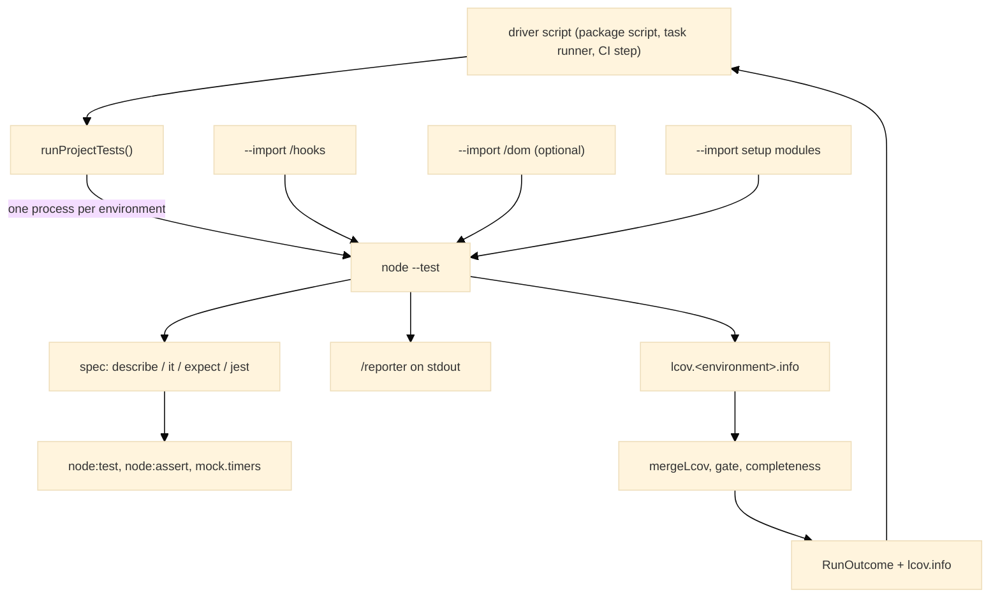
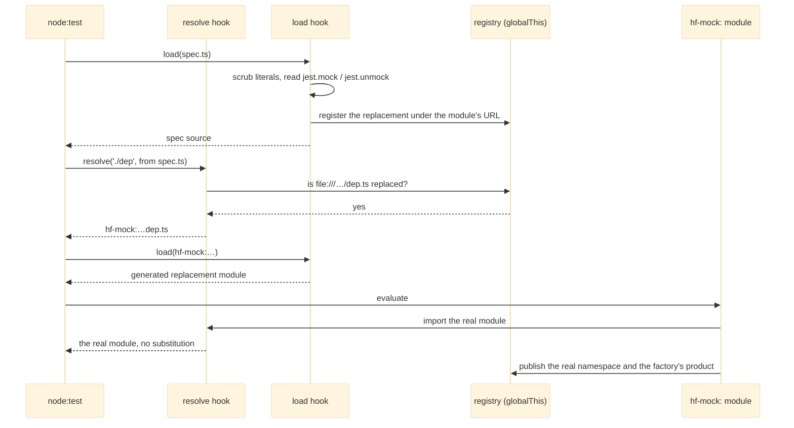
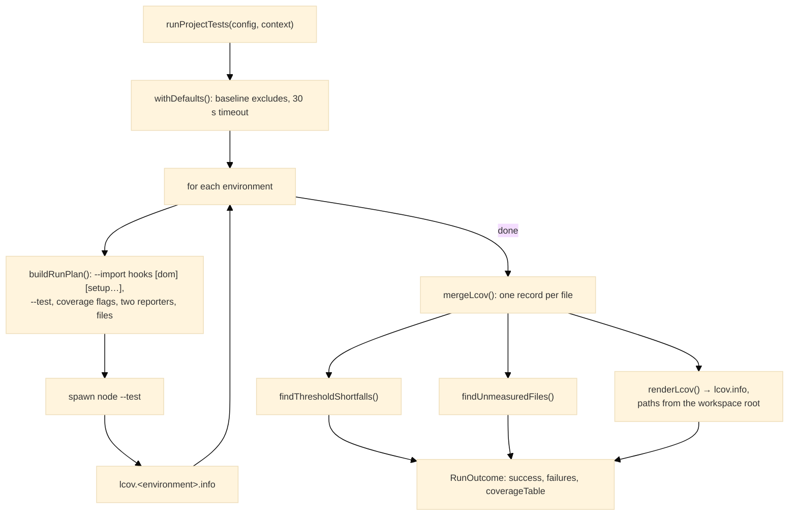

# Architecture

How [`@hyperfrontend/testing`](https://www.hyperfrontend.dev/docs/libraries/testing/) makes a Jest-style spec run on Node's built-in test runner, and where its pieces sit. For installation and a first spec, see the [README](./README.md); for moving a suite over, see [Migrate a Jest suite to Node's test runner](https://www.hyperfrontend.dev/docs/guides/migrate-from-jest-to-node-test/); for each entry's own surface, see the entry pages for [`/hooks`](https://www.hyperfrontend.dev/docs/libraries/testing/hooks/), [`/dom`](https://www.hyperfrontend.dev/docs/libraries/testing/dom/), [`/browser`](https://www.hyperfrontend.dev/docs/libraries/testing/browser/), [`/fs`](https://www.hyperfrontend.dev/docs/libraries/testing/fs/), [`/process`](https://www.hyperfrontend.dev/docs/libraries/testing/process/), [`/consumer`](https://www.hyperfrontend.dev/docs/libraries/testing/consumer/), [`/reporter`](https://www.hyperfrontend.dev/docs/libraries/testing/reporter/), [`/runner`](https://www.hyperfrontend.dev/docs/libraries/testing/runner/) and [`/coverage`](https://www.hyperfrontend.dev/docs/libraries/testing/coverage/).

---

## System Overview

The package is a layer over `node:test`, not a runner of its own. Only the four things Node lacks are reimplemented: a [`describe`](https://www.hyperfrontend.dev/docs/libraries/testing/#api-describe) and [`it`](https://www.hyperfrontend.dev/docs/libraries/testing/#api-it) carrying Jest's modifiers, an [`expect`](https://www.hyperfrontend.dev/docs/libraries/testing/#api-expect) with Jest's matcher names, a [`jest`](https://www.hyperfrontend.dev/docs/libraries/testing/#api-jest) namespace for mock functions, spies and fake timers, and a loader that honours [`jest.mock`](https://www.hyperfrontend.dev/docs/libraries/testing/#api-JestApi) under native ES modules. Lifecycle hooks are imported from `node:test` by the spec itself, a failed matcher throws Node's own [`AssertionError`](https://nodejs.org/api/assert.html#class-assertassertionerror), and the fake clock is Node's [`mock.timers`](https://nodejs.org/api/test.html#class-mocktimers) behind a Jest-shaped surface.

- **Spec surface** (the root entry): the Jest-shaped API, implemented on `node:test`, `node:assert` and Node's fake clock, plus the helpers suites otherwise write for themselves: typed object mocks, waiting on a condition, and promises a test settles by hand.
- **Fixtures and stand-ins** ([`/browser`](https://www.hyperfrontend.dev/docs/libraries/testing/browser/), [`/fs`](https://www.hyperfrontend.dev/docs/libraries/testing/fs/), [`/process`](https://www.hyperfrontend.dev/docs/libraries/testing/process/) and [`/consumer`](https://www.hyperfrontend.dev/docs/libraries/testing/consumer/)): linked windows and a driven `ResizeObserver`, temporary directories written from data a spec declares, fakes for a terminal, the standard streams and child processes, and a packed package installed outside the workspace and driven through plain Node children. None of them acts on import.
- **Preloads** ([`/hooks`](https://www.hyperfrontend.dev/docs/libraries/testing/hooks/) and [`/dom`](https://www.hyperfrontend.dev/docs/libraries/testing/dom/)): modules handed to `node --import` that prepare the process before any spec loads.
- **Reporter** ([`/reporter`](https://www.hyperfrontend.dev/docs/libraries/testing/reporter/)): Node's spec reporter with its per-evaluation coverage summary held back.
- **Runner and coverage** ([`/runner`](https://www.hyperfrontend.dev/docs/libraries/testing/runner/) and [`/coverage`](https://www.hyperfrontend.dev/docs/libraries/testing/coverage/)): one `node --test` process per configured environment, then the lcov merge, the threshold gate and the completeness check.

The root entry never re-exports the preloads, because they act the moment they are imported. Every entry sits in its own directory in the published package, and the runner and the hooks find the other entries by that directory layout, so the package has to stay installed as one unit rather than have entries copied out of it.

---

## How a Spec Is Loaded

ES modules link their imports before any statement runs, so [`jest.mock`](https://www.hyperfrontend.dev/docs/libraries/testing/#api-JestApi) cannot be hoisted the way Jest hoists it. Node does call a module's load hook before resolving that module's imports, and that is where the preload reads the declarations out of a spec's source, with string literals and comments blanked first so a [`jest.mock`](https://www.hyperfrontend.dev/docs/libraries/testing/#api-JestApi) that is text is never taken for one that is code. The substitution happens in the resolve hook, under the package's own `hf-mock:` scheme, because a built-in the loader has already imported would never reach the load hook again. Nothing is loaded at registration except an automock's target, so a barrel that re-exports a module mocked by a later declaration cannot bind the real one first.

The generated replacement imports [`jest`](https://www.hyperfrontend.dev/docs/libraries/testing/#api-jest) from the root entry, imports the real module under its own name, re-exports everything the factory did not define, and publishes both the real namespace and the factory's product for [`jest.requireActual`](https://www.hyperfrontend.dev/docs/libraries/testing/#api-JestApi) and [`jest.requireMock`](https://www.hyperfrontend.dev/docs/libraries/testing/#api-JestApi) to read later. A factory with no body, the automock form, exports a fresh [`jest.fn`](https://www.hyperfrontend.dev/docs/libraries/testing/#api-JestApi) under every name the real module defines.

### Module generations

[`jest.resetModules`](https://www.hyperfrontend.dev/docs/libraries/testing/#api-JestApi) has nothing to evict, because Node's module registry has no eviction API. It advances a counter instead, and from then on every file URL the resolve hook returns carries a generation query, which is a new module to Node and so a fresh evaluation on the next dynamic import. A relative import inside a re-evaluated module strips the query before resolving its neighbours, so the module still finds them, and a replacement's URL carries the generation too, which is why a [`jest.doMock`](https://www.hyperfrontend.dev/docs/libraries/testing/#api-JestApi) declared after a reset is served instead of a cached replacement. The order to keep is reset, then declare, then import dynamically.

### Shared state

The registry, the generation counter, the loader's own resolution, the context a replacement publishes into, and the sets of mock functions, spies and replaced properties all live on `globalThis` under registered symbols rather than in module scope. The resolve hook reaches them from the [`/hooks`](https://www.hyperfrontend.dev/docs/libraries/testing/hooks/) entry and the [`jest`](https://www.hyperfrontend.dev/docs/libraries/testing/#api-jest) object from the root entry, and a build is free to give each entry its own copy of a module; the global object is the one place every copy finds the same state, with no import edge between the two entries. It is also what lets a project's [`clearMocks`](https://www.hyperfrontend.dev/docs/libraries/testing/runner/#api-TestConfig), [`resetMocks`](https://www.hyperfrontend.dev/docs/libraries/testing/runner/#api-TestConfig) and [`restoreMocks`](https://www.hyperfrontend.dev/docs/libraries/testing/runner/#api-TestConfig) options work: the preload registers a [`beforeEach`](https://nodejs.org/api/test.html#beforeeachfn-options) outside any suite, which attaches to each file's root and runs ahead of every test, and the mocks it clears are the ones the spec created through the root entry. Nothing else is global: a spec imports what it uses.

---

## The DOM Preload

Loaded after the hooks and before an environment's setup modules, the [`/dom`](https://www.hyperfrontend.dev/docs/libraries/testing/dom/) entry creates one jsdom window and copies its own properties onto the process global by value. It skips the ECMAScript intrinsics, derived from a bare `node:vm` context so every `instanceof` in the process keeps agreeing with itself, and a reserved set that stays Node's: the timer functions and `performance`, because they are what the fake clock replaces; `crypto`, because Node's implements `subtle`; `URL` and `URLSearchParams`, because `node:url` recognises only its own class; and `atob` and `btoa`, because jsdom's delegate to the global of the same name and a copy would recurse into itself. `window` and its aliases then all point at the process global, so a spy installed on `window.getComputedStyle` is visible to code calling the bare name.

---

## A Configured Run

[`runProjectTests`](https://www.hyperfrontend.dev/docs/libraries/testing/runner/#api-runProjectTests) spawns one process per environment and judges the results together. Each environment is its own process because the preloads act on the process they load into: a DOM installed for one environment would leak into the next, and the resolution hooks cannot be unregistered between runs.

Coverage is judged on the merged report and never on Node's own summary. Node measures each evaluation of a module as a script of its own and omits files no test loaded, so every threshold is compared against an lcov merge keyed by file, with records combined per line, per function and per branch, and the include globs are checked against the report for files that never appeared. Node's own threshold flags are never passed, and the [`/reporter`](https://www.hyperfrontend.dev/docs/libraries/testing/reporter/) entry drops the per-evaluation summary Node would print beside the merged table.

The runner writes nothing to the terminal. The driver prints the table and the failures and sets the exit code, which is what keeps a command-line protocol out of the package: how a driver finds a configuration and where it reports are the driver's own decisions.

---

## Where Behaviour Differs from Jest

The places where the same call cannot behave exactly as it did under Jest, what it does instead, and why. Everything not listed here keeps Jest's semantics; everything Jest provides that is not on the [`jest`](https://www.hyperfrontend.dev/docs/libraries/testing/#api-jest) object or in [`Assertions`](https://www.hyperfrontend.dev/docs/libraries/testing/#api-Assertions) is not provided at all.

| Concern                                                                                                                                                                       | What this package does                                                                                                                                                                                                                                                                                                                                                                                                                                 |
| ----------------------------------------------------------------------------------------------------------------------------------------------------------------------------- | ------------------------------------------------------------------------------------------------------------------------------------------------------------------------------------------------------------------------------------------------------------------------------------------------------------------------------------------------------------------------------------------------------------------------------------------------------ |
| Coverage provider                                                                                                                                                             | V8 through Node's collector, not istanbul. `/* istanbul ignore */` has no effect; use `/* node:coverage ignore next N */`. Branch percentages read lower because V8 counts default parameters and optional chaining.                                                                                                                                                                                                                                   |
| Files no test loaded                                                                                                                                                          | Node omits them from the report. The completeness check fails the run and names each one, which is what a full-coverage threshold is meant to guarantee.                                                                                                                                                                                                                                                                                               |
| Re-evaluated modules                                                                                                                                                          | Node measures each evaluation as a file of its own, so a suite calling [`jest.resetModules`](https://www.hyperfrontend.dev/docs/libraries/testing/#api-JestApi) would be judged once per generation. The gate merges the records per file and judges the thresholds itself.                                                                                                                                                                            |
| statements                                                                                                                                                                    | Node has no such metric. Carry a statements threshold as [`lines`](https://www.hyperfrontend.dev/docs/libraries/testing/runner/#api-CoverageThresholds).                                                                                                                                                                                                                                                                                               |
| [`it.todo`](https://www.hyperfrontend.dev/docs/libraries/testing/#api-ItApi)                                                                                                  | Any body is ignored, as under Jest. `node:test` on its own would run it.                                                                                                                                                                                                                                                                                                                                                                               |
| [`it.only`](https://www.hyperfrontend.dev/docs/libraries/testing/#api-ItApi)                                                                                                  | Honoured only when Node runs with `--test-only`; without the flag every test runs. [`runProjectTests`](https://www.hyperfrontend.dev/docs/libraries/testing/runner/#api-runProjectTests) does not pass it.                                                                                                                                                                                                                                             |
| [`expect.assertions`](https://www.hyperfrontend.dev/docs/libraries/testing/#api-expect)                                                                                       | Verified when a body returns or its promise settles. A body that takes the [`done`](https://www.hyperfrontend.dev/docs/libraries/testing/#api-TestBody) callback is not checked.                                                                                                                                                                                                                                                                       |
| Fake timers                                                                                                                                                                   | Only `setTimeout`, `setInterval`, [`setImmediate`](https://nodejs.org/api/timers.html#setimmediatecallback-args) and `Date` are faked. `process.nextTick`, `queueMicrotask`, `requestAnimationFrame` and `performance` stay real.                                                                                                                                                                                                                      |
| [`runAllTimers`](https://www.hyperfrontend.dev/docs/libraries/testing/#api-JestApi)                                                                                           | Node's own drain runs only the queue as it stood when called. The queue is re-run until no timeout is outstanding, which is what Jest does, and abandoned after a thousand passes. [`runOnlyPendingTimers`](https://www.hyperfrontend.dev/docs/libraries/testing/#api-JestApi) is the same call.                                                                                                                                                       |
| [`clearAllTimers`](https://www.hyperfrontend.dev/docs/libraries/testing/#api-JestApi)                                                                                         | Node has no primitive, so the clock is torn down and rebuilt at the same instant.                                                                                                                                                                                                                                                                                                                                                                      |
| [`advanceTimersByTimeAsync`](https://www.hyperfrontend.dev/docs/libraries/testing/#api-JestApi)                                                                               | Advances the clock, then yields one microtask turn so promise callbacks the timers scheduled settle before the caller asserts.                                                                                                                                                                                                                                                                                                                         |
| Timer delays                                                                                                                                                                  | A delay below one millisecond is raised to one, as the real schedulers do. A spy on the scheduler still records what the caller passed.                                                                                                                                                                                                                                                                                                                |
| [`jest.replaceProperty`](https://www.hyperfrontend.dev/docs/libraries/testing/#api-JestApi)                                                                                   | Accepts an accessor, an inherited property or a function, all of which Jest refuses: the replacement is always an own data property, which is what a prototype getter such as `navigator.userAgent` needs. The property must still exist; [`jest.stubGlobal`](https://www.hyperfrontend.dev/docs/libraries/testing/#api-JestApi) and [`jest.stubEnv`](https://www.hyperfrontend.dev/docs/libraries/testing/#api-JestApi) cover names that may not.     |
| [`mockReset`](https://www.hyperfrontend.dev/docs/libraries/testing/#api-MockFn) and [`jest.resetAllMocks`](https://www.hyperfrontend.dev/docs/libraries/testing/#api-JestApi) | Return a mock to the implementation it was created with: the function passed to [`jest.fn`](https://www.hyperfrontend.dev/docs/libraries/testing/#api-JestApi), or the original for a spy, as Vitest does. Jest empties it instead. Keeping it is what lets stand-ins built on mocks, such as linked windows and fake child processes, survive the [`resetMocks`](https://www.hyperfrontend.dev/docs/libraries/testing/runner/#api-TestConfig) option. |
| Partial mocks                                                                                                                                                                 | A factory naming only some exports leaves the rest reachable and real. Under Jest they were undefined, but under ES modules importing an undefined name is a link error that stops the whole file.                                                                                                                                                                                                                                                     |
| Automocks                                                                                                                                                                     | [`jest.mock`](https://www.hyperfrontend.dev/docs/libraries/testing/#api-JestApi) with no factory replaces every export with a fresh [`jest.fn`](https://www.hyperfrontend.dev/docs/libraries/testing/#api-JestApi). The module is loaded once to learn its export names.                                                                                                                                                                               |
| Namespace spies                                                                                                                                                               | [`jest.spyOn`](https://www.hyperfrontend.dev/docs/libraries/testing/#api-JestApi) on an ES module namespace cannot work: the namespace is sealed and importers bind the name at link time. Declare a replacement whose factory wraps the function instead.                                                                                                                                                                                             |
| [`jest.doMock`](https://www.hyperfrontend.dev/docs/libraries/testing/#api-JestApi)                                                                                            | Reaches modules imported after it, never ones already linked. Call [`jest.resetModules`](https://www.hyperfrontend.dev/docs/libraries/testing/#api-JestApi) first, then declare the replacement, then import dynamically.                                                                                                                                                                                                                              |
| Where [`jest.mock`](https://www.hyperfrontend.dev/docs/libraries/testing/#api-JestApi) is read                                                                                | Out of files recognised by name, `.spec` or `.test` before `.ts`, `.tsx`, `.mts`, `.cts`, `.js`, `.jsx`, `.mjs` or `.cjs`, and out of declared setup files. A declaration in a helper module a spec imports is not read.                                                                                                                                                                                                                               |
| [`each`](https://www.hyperfrontend.dev/docs/libraries/testing/#api-ItApi) tables                                                                                              | The array form only. The tagged template form is not supported.                                                                                                                                                                                                                                                                                                                                                                                        |
| Decorators                                                                                                                                                                    | Node's type stripping does not parse them. A decorated class in a spec applies its decorator explicitly, the way the compiler would.                                                                                                                                                                                                                                                                                                                   |
| Test counting                                                                                                                                                                 | A spec file reports its results to the runner as serialized messages on its own stdout, so a hand-rolled stub of `process.stdout.write` held across an `await` drops earlier tests from the counts; the exit code is unaffected. [`captureStdio`](https://www.hyperfrontend.dev/docs/libraries/testing/process/#api-captureStdio) recognises those messages and lets them through.                                                                     |
| HTML report                                                                                                                                                                   | None. A run produces the per-file table, lcov.info with the merged records, and `lcov.<environment>.info` with each environment's raw report.                                                                                                                                                                                                                                                                                                          |
