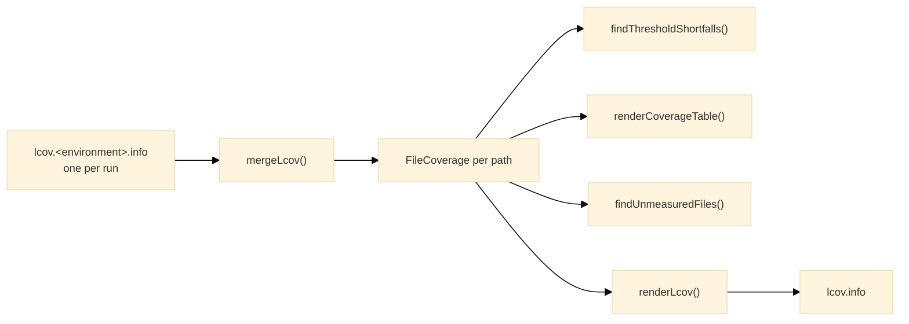

# coverage

The coverage side of a run: lcov reports merged per file, the threshold gate, the per-file table, and the completeness check for source files no test loaded.

## Overview

Node's test runner can write an lcov report, and this entry is what turns one or more of those reports into a verdict.



[`mergeLcov`](https://www.hyperfrontend.dev/docs/libraries/testing/coverage/#api-mergeLcov) reads the reports and returns one [`FileCoverage`](https://www.hyperfrontend.dev/docs/libraries/testing/coverage/#api-FileCoverage) per path, holding execution counts per line, per function and per branch. [`fileTotals`](https://www.hyperfrontend.dev/docs/libraries/testing/coverage/#api-fileTotals) and [`overallTotals`](https://www.hyperfrontend.dev/docs/libraries/testing/coverage/#api-overallTotals) reduce those counters to found-and-hit pairs, [`percentOf`](https://www.hyperfrontend.dev/docs/libraries/testing/coverage/#api-percentOf) turns a pair into a percentage, and [`uncoveredRanges`](https://www.hyperfrontend.dev/docs/libraries/testing/coverage/#api-uncoveredRanges) lists the lines a file never ran as ranges. [`renderLcov`](https://www.hyperfrontend.dev/docs/libraries/testing/coverage/#api-renderLcov) writes the merged files back out as a single report for a coverage service to read.

## Why reports are merged

Node measures each evaluation of a module as a script of its own, so after [`jest.resetModules`](https://www.hyperfrontend.dev/docs/libraries/testing/#api-JestApi) a later import re-runs the module body and the report carries one record per evaluation. Treating those as separate files counts every line of the module once per evaluation while crediting only the evaluation that ran it, which drags the percentages down in proportion to how often a suite reset. Combining the records per file is what Jest's provider did implicitly. Reports from different environments merge the same way, so a file exercised by one environment and merely imported by another is judged on both.

The merge keys are chosen to hold still between runs. Node numbers anonymous functions by discovery order and numbers branch blocks in a way that shifts between runs and environments, so functions are keyed by declaration line and name with the anonymous numbering folded, and branches by line and branch index rather than block. Anything a `node:coverage ignore` comment covers is dropped rather than measured: Node omits an ignored line from the report but still writes the branches and functions sitting on it, marked untaken, and dropping them is what `istanbul ignore` used to mean.

## What the gate judges

[`findThresholdShortfalls`](https://www.hyperfrontend.dev/docs/libraries/testing/coverage/#api-findThresholdShortfalls) compares the merged totals of the whole project against the [`CoverageThresholds`](https://www.hyperfrontend.dev/docs/libraries/testing/runner/#api-CoverageThresholds) a project declares for lines, branches and functions, which is what a Jest `global` threshold meant, and returns one message per threshold missed. A metric with nothing to measure counts as complete, which is what Jest reported for a file holding no branches at all. There is no statements metric: Node does not measure one.

[`findUnmeasuredFiles`](https://www.hyperfrontend.dev/docs/libraries/testing/coverage/#api-findUnmeasuredFiles) restores the guarantee a full-coverage threshold is supposed to give. Node's report only names files the run loaded, so a source file no test imports vanishes instead of landing at zero percent, and a new, wholly untested file would not fail the build. Comparing the report against the include globs, less the exclude globs, names every file that should have been measured and was not.

[`renderCoverageTable`](https://www.hyperfrontend.dev/docs/libraries/testing/coverage/#api-renderCoverageTable) is the human-readable form: one row per file with line, branch and function percentages and the uncovered line ranges, closed by the project's totals.

## Usage

The runner calls all of this for you. Reach for the entry directly to judge reports another tool wrote, or to read a merged report off disk:

```typescript
import { mergeLcov, overallTotals, percentOf, renderCoverageTable } from '@hyperfrontend/testing/coverage'

const reports = ['coverage/lcov.node.info', 'coverage/lcov.browser.info']
const files = [...mergeLcov(reports).values()]

for (const row of renderCoverageTable(files)) console.log(row)
console.log(`${percentOf(overallTotals(files).lines).toFixed(2)}% of lines ran`)
```
