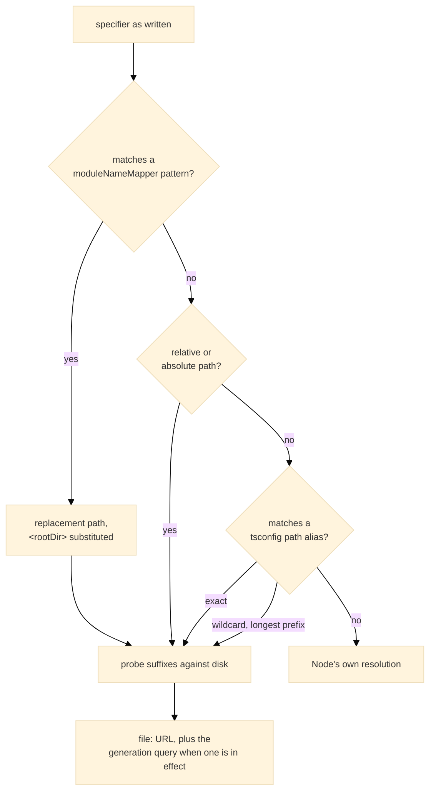

# hooks

The preload that makes a Jest-style spec loadable by Node's test runner: path aliases, extensionless TypeScript specifiers, specifier redirects, and [`jest.mock`](https://www.hyperfrontend.dev/docs/libraries/testing/#api-JestApi) replacements applied before a spec's imports link.

## Overview

The entry registers its hooks the moment it is imported, which is why it is handed to Node as a preload and why the package's root entry never re-exports it:

```bash
node --import @hyperfrontend/testing/hooks --test 'src/**/*.spec.ts'
```

[`registerResolutionHooks`](https://www.hyperfrontend.dev/docs/libraries/testing/hooks/#api-registerResolutionHooks) installs one resolve hook and one load hook through `module.registerHooks`. The runner behind [`runProjectTests`](https://www.hyperfrontend.dev/docs/libraries/testing/runner/#api-runProjectTests) passes the same entry by file URL, so a hand-run `node --test` and a configured run resolve modules identically.

### Resolution

Every specifier Node cannot resolve on its own is tried in this order, and anything that falls through is left to Node, so `node:` built-ins and installed packages keep their normal behaviour:



The suffixes are probed in a fixed order: the specifier as written, then `.ts`, `.tsx`, `.mts`, `.cts`, `/index.ts`, `/index.tsx` and last `.js`, so a compiled sibling never wins over the TypeScript source beside it. Aliases are read from the [`paths`](https://www.typescriptlang.org/tsconfig/#paths) of the `tsconfig.base.json` at the workspace root; a workspace without one has no aliases and bare specifiers go straight to Node. A `.json` import is given the `type: 'json'` attribute native ES modules require, so the bundler-era spelling keeps working at test time.

### Environment

The hooks run in the test process and take their settings from the environment, which is how the runner reaches them across the process boundary. Every variable is optional.

| Variable               | Value                                                                                                                                                                                                                                                                 | Default                          |
| ---------------------- | --------------------------------------------------------------------------------------------------------------------------------------------------------------------------------------------------------------------------------------------------------------------- | -------------------------------- |
| HF_TEST_WORKSPACE_ROOT | Absolute path of the directory holding `tsconfig.base.json`, which alias targets are resolved against.                                                                                                                                                                | The current working directory    |
| HF_TEST_MODULE_MAP     | JSON array of `[pattern, replacement]` pairs, the equivalent of [`moduleNameMapper`](https://www.hyperfrontend.dev/docs/libraries/testing/runner/#api-TestConfig); `<rootDir>` in a replacement is the current working directory and `$1` captures are honoured.      | No redirects                     |
| HF_TEST_SETUP_FILES    | JSON array of absolute paths naming the environment's setup modules, whose [`jest.mock`](https://www.hyperfrontend.dev/docs/libraries/testing/#api-JestApi) calls are read.                                                                                           | No setup modules                 |
| HF_TEST_ALIASES        | JSON object in [`paths`](https://www.typescriptlang.org/tsconfig/#paths) form that replaces the aliases read from disk outright, for a run whose specifiers must resolve differently from what the tsconfig declares, such as against an installed copy of a package. | The `tsconfig.base.json` aliases |

[`runProjectTests`](https://www.hyperfrontend.dev/docs/libraries/testing/runner/#api-runProjectTests) sets the first three from its context and the project's [`TestConfig`](https://www.hyperfrontend.dev/docs/libraries/testing/runner/#api-TestConfig); a hand run sets whichever it needs.

## Module replacements

Jest hoists [`jest.mock`](https://www.hyperfrontend.dev/docs/libraries/testing/#api-JestApi) above the imports a spec compiles down to. ES modules have no equivalent, so the declarations are read out of the spec's source text as it loads, before its imports link, with string literals and comments blanked first so a [`jest.mock`](https://www.hyperfrontend.dev/docs/libraries/testing/#api-JestApi) inside a template or a comment registers nothing. How a replacement is generated, served and reset is described in [How a Spec Is Loaded](https://www.hyperfrontend.dev/docs/libraries/testing/architecture/#how-a-spec-is-loaded).

What a spec can rely on:

- A file counts as a spec by its name, the way Jest's default pattern recognises one: `.spec` or `.test` before `.ts`, `.tsx`, `.mts`, `.cts`, `.js`, `.jsx`, `.mjs` or `.cjs`. A declaration inside a helper module a spec imports is never read.
- A setup module named in HF_TEST_SETUP_FILES has its declarations applied to every spec in the environment. A spec's own declaration for the same module wins, and [`jest.unmock`](https://www.hyperfrontend.dev/docs/libraries/testing/#api-JestApi) in a spec removes the setup module's registration for that spec.
- A factory that names only some exports leaves the rest reachable and real, where Jest left them undefined; under ES modules an undefined import would be a link error that stops the whole file.
- The automock form, [`jest.mock`](https://www.hyperfrontend.dev/docs/libraries/testing/#api-JestApi) with no factory, replaces every export with a fresh [`jest.fn`](https://www.hyperfrontend.dev/docs/libraries/testing/#api-JestApi). It is the one case where the module is loaded at registration, to learn its export names.
- [`jest.resetModules`](https://www.hyperfrontend.dev/docs/libraries/testing/#api-JestApi) makes later dynamic imports evaluate their target again, and a [`jest.doMock`](https://www.hyperfrontend.dev/docs/libraries/testing/#api-JestApi) declared after it is served instead of a cached replacement. The order to keep is reset, then declare, then import dynamically.
- A [`jest.mock`](https://www.hyperfrontend.dev/docs/libraries/testing/#api-JestApi) naming a path alias is resolved by the same function the resolve hook uses, so it registers against the module the spec will import.
