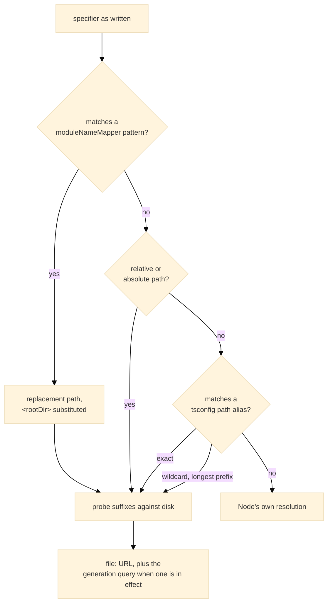
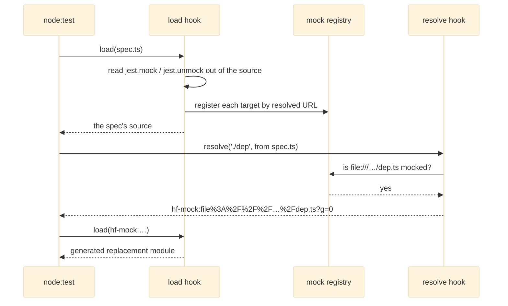

# hooks

The preload that makes a Jest-style spec loadable by Node's test runner: path aliases, extensionless TypeScript specifiers, specifier redirects, and [`jest.mock`](https://www.hyperfrontend.dev/docs/libraries/testing/#api-JestApi) replacements applied before a spec's imports link.

## Overview

The entry registers its hooks the moment it is imported, which is why it is handed to Node as a preload and why the package's root entry never re-exports it:

```bash
node --import @hyperfrontend/testing/hooks --test 'src/**/*.spec.ts'
```

[`registerResolutionHooks`](https://www.hyperfrontend.dev/docs/libraries/testing/hooks/#api-registerResolutionHooks) installs one resolve hook and one load hook through `module.registerHooks`. The runner behind [`runProjectTests`](https://www.hyperfrontend.dev/docs/libraries/testing/runner/#api-runProjectTests) passes the same entry by file URL, so a hand-run `node --test` and a configured run resolve modules identically.

### Resolution

Every specifier Node cannot resolve on its own is tried in this order, and anything that falls through is left to Node, so `node:` built-ins and installed packages keep their normal behaviour:



The suffixes are probed in a fixed order: the specifier as written, then `.ts`, `.tsx`, `.mts`, `.cts`, `/index.ts`, `/index.tsx` and last `.js`, so a compiled sibling never wins over the TypeScript source beside it. Aliases are read from the [`paths`](https://www.typescriptlang.org/tsconfig/#paths) of the `tsconfig.base.json` at the workspace root; a workspace without one has no aliases and bare specifiers go straight to Node. A `.json` import is given the `type: 'json'` attribute native ES modules require, so the bundler-era spelling keeps working at test time.

### Environment

The hooks run in the test process and take their settings from the environment, which is how the runner reaches them across the process boundary. Every variable is optional.

| Variable               | Value                                                                                                                                                                                                                                                                 | Default                          |
| ---------------------- | --------------------------------------------------------------------------------------------------------------------------------------------------------------------------------------------------------------------------------------------------------------------- | -------------------------------- |
| HF_TEST_WORKSPACE_ROOT | Absolute path of the directory holding `tsconfig.base.json`, which alias targets are resolved against.                                                                                                                                                                | The current working directory    |
| HF_TEST_MODULE_MAP     | JSON array of `[pattern, replacement]` pairs, the equivalent of [`moduleNameMapper`](https://www.hyperfrontend.dev/docs/libraries/testing/runner/#api-TestConfig); `<rootDir>` in a replacement is the current working directory and `$1` captures are honoured.      | No redirects                     |
| HF_TEST_SETUP_FILES    | JSON array of absolute paths naming the environment's setup modules, whose [`jest.mock`](https://www.hyperfrontend.dev/docs/libraries/testing/#api-JestApi) calls are read.                                                                                           | No setup modules                 |
| HF_TEST_ALIASES        | JSON object in [`paths`](https://www.typescriptlang.org/tsconfig/#paths) form that replaces the aliases read from disk outright, for a run whose specifiers must resolve differently from what the tsconfig declares, such as against an installed copy of a package. | The `tsconfig.base.json` aliases |

[`runProjectTests`](https://www.hyperfrontend.dev/docs/libraries/testing/runner/#api-runProjectTests) sets the first three from its context and the project's [`TestConfig`](https://www.hyperfrontend.dev/docs/libraries/testing/runner/#api-TestConfig); a hand run sets whichever it needs.

## Module replacements

Jest hoists [`jest.mock`](https://www.hyperfrontend.dev/docs/libraries/testing/#api-JestApi) above the `require` calls a spec compiles down to. ES modules have no equivalent: imports are linked before any statement runs. The loophole is that Node calls a module's load hook before it resolves that module's imports, so the declarations are read out of the spec's source text there, with string literals and comments blanked first so that a [`jest.mock`](https://www.hyperfrontend.dev/docs/libraries/testing/#api-JestApi) inside a template or a comment registers nothing.

A file counts as a spec by its name, the way Jest's default pattern recognises one: `.spec` or `.test` before `.ts`, `.tsx`, `.mts`, `.cts`, `.js`, `.jsx`, `.mjs` or `.cjs`. A setup module is not recognisable by name, which is what HF_TEST_SETUP_FILES is for: its declarations are registered before any spec loads and apply to every spec in the environment, and a spec's own declaration for the same module is read later and wins. [`jest.unmock`](https://www.hyperfrontend.dev/docs/libraries/testing/#api-JestApi) in a spec removes a setup module's registration for that spec. A declaration inside a helper module a spec imports is never read.



Nothing is loaded at registration time. Resolving a specifier is enough to know which URL to replace, and loading the module would pull its importers in early: a barrel re-exporting a module mocked by a later declaration would bind the real one and keep it. The one exception is the automock form, which has no factory to generate exports from and loads the module once to read its export names.

The substitution happens in the resolve hook rather than the load hook, under the package's own `hf-mock:` scheme, because a built-in the loader has already imported would never reach the load hook again. The generated replacement imports the real module by URL, publishes its namespace for [`jest.requireActual`](https://www.hyperfrontend.dev/docs/libraries/testing/#api-JestApi), re-exports every real export, runs the factory verbatim, publishes its product for [`jest.requireMock`](https://www.hyperfrontend.dev/docs/libraries/testing/#api-JestApi), and exports each key of the factory's object literal under its own name. Because the real exports pass through, a factory that names only some of them leaves the rest reachable, where Jest left them undefined; under ES modules an undefined import would be a link error.

### Generations

Node's module registry has no eviction API. [`jest.resetModules`](https://www.hyperfrontend.dev/docs/libraries/testing/#api-JestApi) advances a counter kept on `globalThis` under a registered symbol, and from then on every file URL the resolve hook returns carries `?__hfGeneration=N`, which is a new module to Node and so a fresh evaluation. A relative import inside a re-evaluated module strips the query before resolving its neighbours, and a replacement's URL carries the generation too, so a [`jest.doMock`](https://www.hyperfrontend.dev/docs/libraries/testing/#api-JestApi) declared after a reset is served instead of a cached replacement. That ordering is the one to keep: reset, then declare, then import dynamically.

## Design

The registry, the generation counter and the context a replacement publishes into all live on `globalThis` under registered symbols rather than in module scope. The resolve hook and the [`jest`](https://www.hyperfrontend.dev/docs/libraries/testing/#api-jest) object reach them from different entries of the package, and a build is free to give each entry its own copy of a module; a key on the global object is the one place every copy finds the same state.

The registry resolves a declaration's specifier with the same function the resolve hook uses. Without that, a [`jest.mock`](https://www.hyperfrontend.dev/docs/libraries/testing/#api-JestApi) naming a path alias would resolve nowhere and register nothing, silently leaving the real module in place.
