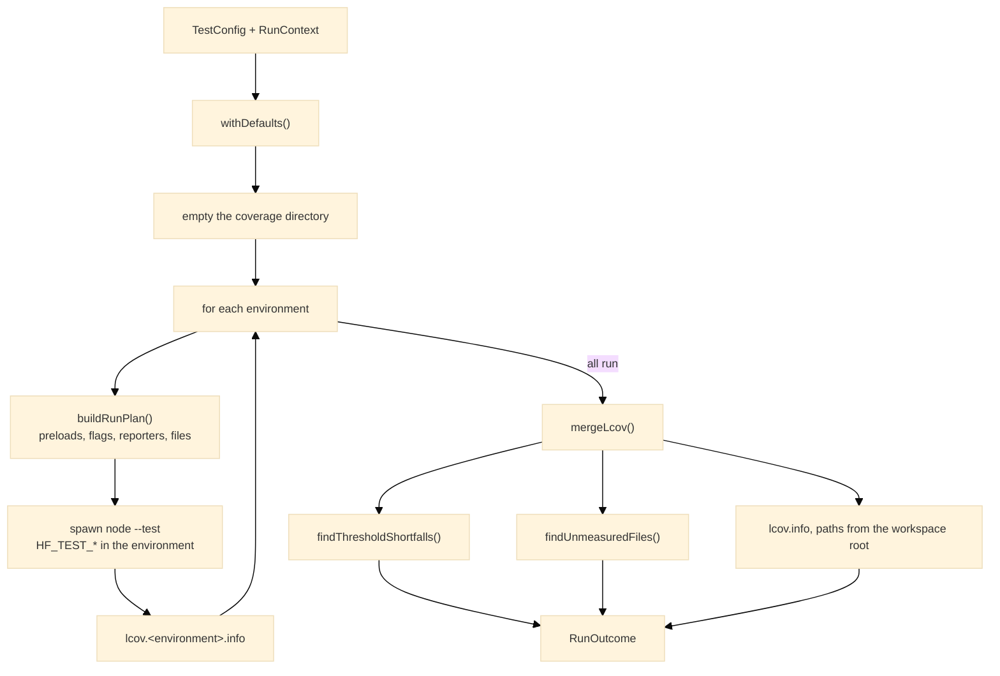

# runner

The runner behind a project's `test.config.ts`: one `node --test` run per environment, then the merged coverage report, the threshold gate and the completeness check.

## Configuration

A project exports one [`TestConfig`](https://www.hyperfrontend.dev/docs/libraries/testing/runner/#api-TestConfig) from its `test.config.ts`. It takes the place of a Jest configuration, and most of its fields have a direct Jest ancestor.

| Field                                                                                               | Meaning                                                                                                                                                                                                                                                                                                                                                         |
| --------------------------------------------------------------------------------------------------- | --------------------------------------------------------------------------------------------------------------------------------------------------------------------------------------------------------------------------------------------------------------------------------------------------------------------------------------------------------------- |
| [`environments`](https://www.hyperfrontend.dev/docs/libraries/testing/runner/#api-TestConfig)       | The runs to make, in order. Each is a [`TestEnvironment`](https://www.hyperfrontend.dev/docs/libraries/testing/runner/#api-TestEnvironment) with its own file selection and setup.                                                                                                                                                                              |
| [`coverageInclude`](https://www.hyperfrontend.dev/docs/libraries/testing/runner/#api-TestConfig)    | Globs, relative to the project root, naming every file that must be measured.                                                                                                                                                                                                                                                                                   |
| [`coverageExclude`](https://www.hyperfrontend.dev/docs/libraries/testing/runner/#api-TestConfig)    | Globs naming files exempt from measurement, on top of the baseline every project inherits.                                                                                                                                                                                                                                                                      |
| [`coverageThresholds`](https://www.hyperfrontend.dev/docs/libraries/testing/runner/#api-TestConfig) | Minimum [`lines`](https://www.hyperfrontend.dev/docs/libraries/testing/runner/#api-CoverageThresholds), [`branches`](https://www.hyperfrontend.dev/docs/libraries/testing/runner/#api-CoverageThresholds) and [`functions`](https://www.hyperfrontend.dev/docs/libraries/testing/runner/#api-CoverageThresholds) percentages, judged on the project as a whole. |
| [`moduleNameMapper`](https://www.hyperfrontend.dev/docs/libraries/testing/runner/#api-TestConfig)   | Specifier patterns redirected before normal resolution, with `<rootDir>` standing for the project root and `$1` captures honoured.                                                                                                                                                                                                                              |
| [`testTimeout`](https://www.hyperfrontend.dev/docs/libraries/testing/runner/#api-TestConfig)        | Per-test timeout in milliseconds. Defaults to 30 seconds.                                                                                                                                                                                                                                                                                                       |

An environment names itself (the name lands in the output and in `lcov.<name>.info`), selects files with [`testMatch`](https://www.hyperfrontend.dev/docs/libraries/testing/runner/#api-TestEnvironment) and [`testIgnore`](https://www.hyperfrontend.dev/docs/libraries/testing/runner/#api-TestEnvironment), asks for a DOM with [`dom`](https://www.hyperfrontend.dev/docs/libraries/testing/runner/#api-TestEnvironment), and lists the modules to preload in [`setupFiles`](https://www.hyperfrontend.dev/docs/libraries/testing/runner/#api-TestEnvironment), which is what Jest's [`setupFilesAfterEnv`](https://jestjs.io/docs/configuration#setupfilesafterenv-array) did. [`withDefaults`](https://www.hyperfrontend.dev/docs/libraries/testing/runner/#api-withDefaults) fills in what a project leaves out: the timeout, and the exclusions in [`BASELINE_COVERAGE_EXCLUDE`](https://www.hyperfrontend.dev/docs/libraries/testing/runner/#api-BASELINE_COVERAGE_EXCLUDE), which keep spec files, declaration files and the configuration itself out of what coverage measures.

## Run sequence

[`runProjectTests`](https://www.hyperfrontend.dev/docs/libraries/testing/runner/#api-runProjectTests) takes the configuration and a [`RunContext`](https://www.hyperfrontend.dev/docs/libraries/testing/runner/#api-RunContext) naming the workspace root, the project root and the coverage directory, and returns a [`RunOutcome`](https://www.hyperfrontend.dev/docs/libraries/testing/runner/#api-RunOutcome): whether the run passed, the reasons it did not, and the per-file table as lines of text.



Each environment is its own process, started with the hooks preload, the DOM preload when asked for, and each setup module as a further preload, in that order, so a setup module can resolve its imports and assume `document` exists. The process always collects coverage, with the include and exclude globs and the environment's [`testIgnore`](https://www.hyperfrontend.dev/docs/libraries/testing/runner/#api-TestEnvironment) passed as Node's own coverage flags, and writes its raw report through Node's lcov reporter while the package's spec reporter prints to stdout.

An environment that ignores nothing hands its globs to Node; one that does has them expanded first, because Node has no way to exclude files from a `--test` glob, and an expansion that matches nothing is an error rather than a fallback to Node's own discovery.

The reports are merged rather than read one at a time, because a module evaluated again after [`jest.resetModules`](https://www.hyperfrontend.dev/docs/libraries/testing/#api-JestApi) is a separate file to Node and one file to the gate, and because a file exercised by one environment and merely imported by another is judged on both. Thresholds are then compared against the merged totals, which is what a Jest `global` threshold meant, and every file the include globs name that no environment loaded is reported by path. Node omits such files from its report entirely, so without that check a wholly untested source file would pass a full-coverage gate.

## Usage

A driver is a few lines. It decides what to print and what the exit code is; the runner itself writes nothing to the terminal:

```typescript
import { runProjectTests } from '@hyperfrontend/testing/runner'
import config from './test.config.ts'

const outcome = runProjectTests(config, {
  workspaceRoot: import.meta.dirname,
  projectRoot: import.meta.dirname,
  coverageDir: `${import.meta.dirname}/coverage`,
})

for (const row of outcome.coverageTable) console.log(row)
for (const failure of outcome.failures) console.error(failure)
process.exitCode = outcome.success ? 0 : 1
```

Setting [`silent`](https://www.hyperfrontend.dev/docs/libraries/testing/runner/#api-RunContext) keeps the child processes' output off the terminal. A failure reads as it will be shown: `environment "node" reported failures`, `93.75% branch coverage does not meet threshold of 95%`, or `no test loaded these files, so coverage never measured them:` followed by one path per line.

[`it.only`](https://www.hyperfrontend.dev/docs/libraries/testing/#api-ItApi) is not honoured through the runner, because Node only applies it under `--test-only` and the runner does not pass that flag; a focused run is a hand-run `node --test --test-only`.

## Design

The run is a child process per environment rather than an in-process call because the preloads act on the process they load into: a DOM installed for one environment would leak into the next, and the resolution hooks cannot be unregistered between runs. The configuration is evaluated by the same Node that runs the specs, through Node's own type stripping, so no loader has to agree with another about what the file means.

The protocol between a driver and the runner is the [`runProjectTests`](https://www.hyperfrontend.dev/docs/libraries/testing/runner/#api-runProjectTests) call itself. How a driver finds the configuration, where it puts coverage, and how it reports are the driver's own decisions, which is why no command-line interface ships in this entry. A driver that itself runs inside a `node --test` process, or inherits the HF*TEST*\* variables of an outer run, should clear them before calling the runner, or the children it spawns will resolve against the outer run's settings.
