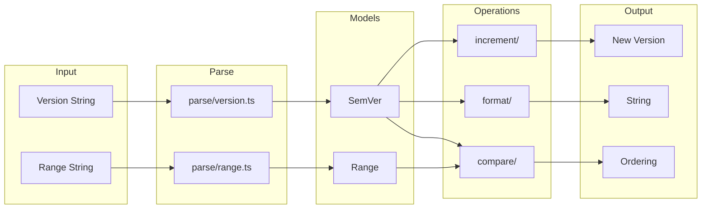

# semver/

Semantic versioning utilities for parsing, comparing, formatting, and incrementing versions.

## Overview

Complete implementation of the [Semantic Versioning 2.0.0](https://semver.org/) specification. Parsing uses character-by-character state machines for predictable O(n) performance.



## Usage Examples

### Parsing Versions

```typescript
import { parseVersion, parseVersionStrict, coerceVersion } from '@hyperfrontend/versioning'

// Safe parsing (returns a result, never throws)
const parsed = parseVersion('1.2.3') // { success: true, version: SemVer 1.2.3 }
const failed = parseVersion('invalid') // { success: false, error: 'Expected digit' }

// Strict parsing (returns the SemVer, throws on invalid)
const v3 = parseVersionStrict('2.0.0-beta.1')

// Coerce with best effort (returns null when no version can be read)
const v4 = coerceVersion('v1.2.3') // strips 'v' prefix
const v5 = coerceVersion('1.2') // normalizes to 1.2.0
```

### Comparing Versions

```typescript
import { compare, gt, lt, satisfies, parseVersionStrict, parseRangeStrict } from '@hyperfrontend/versioning'

const a = parseVersionStrict('1.0.0')
const b = parseVersionStrict('2.0.0')

compare(a, b) // -1 (a < b)
gt(b, a) // true
lt(a, b) // true

// Range satisfaction, with ranges read the way npm reads them
const range = parseRangeStrict('^1.0.0')
satisfies(parseVersionStrict('1.5.0'), range) // true
satisfies(parseVersionStrict('2.0.0'), range) // false

// A partial version stands for every version it leaves open
satisfies(parseVersionStrict('18.3.1'), parseRangeStrict('18 || 20')) // true
```

### Incrementing Versions

```typescript
import { increment, parseVersionStrict, format } from '@hyperfrontend/versioning'

const version = parseVersionStrict('1.2.3')

format(increment(version, 'major')) // '2.0.0'
format(increment(version, 'minor')) // '1.3.0'
format(increment(version, 'patch')) // '1.2.4'
format(increment(version, 'prerelease')) // '1.2.4-alpha.0'
```

### Sorting Versions

```typescript
import { sort, max, min, parseVersionStrict, format } from '@hyperfrontend/versioning'

const versions = ['2.0.0', '1.0.0', '1.5.0'].map(parseVersionStrict)

sort(versions).map(format) // ['1.0.0', '1.5.0', '2.0.0']
max(versions) // SemVer 2.0.0, or null for an empty list
min(versions) // SemVer 1.0.0, or null for an empty list
```

## Design Principles

1. **Immutable**: All operations return new objects
2. **Pure Functions**: No side effects, deterministic output
3. **No Regex**: Character-by-character parsing eliminates ReDoS
4. **No Surprise Throws**: Parsing reports failure in the result it returns, and only the strict variants throw
5. **Factory Pattern**: Use `create*` functions for object construction

## See Also

- [changelog/](../changelog/README.md): Uses semver for version entries
- [flow/](../flow/README.md): Uses semver for bump calculations
- [commits/](../commits/README.md): Maps commit types to bump types
- [registry/](../registry/README.md): Queries published versions
- [workspace/](../workspace/README.md): Cascade bump calculations
- [Main README](../../README.md): Package overview and quick start
- [ARCHITECTURE.md](../../ARCHITECTURE.md): Design principles and data flow
