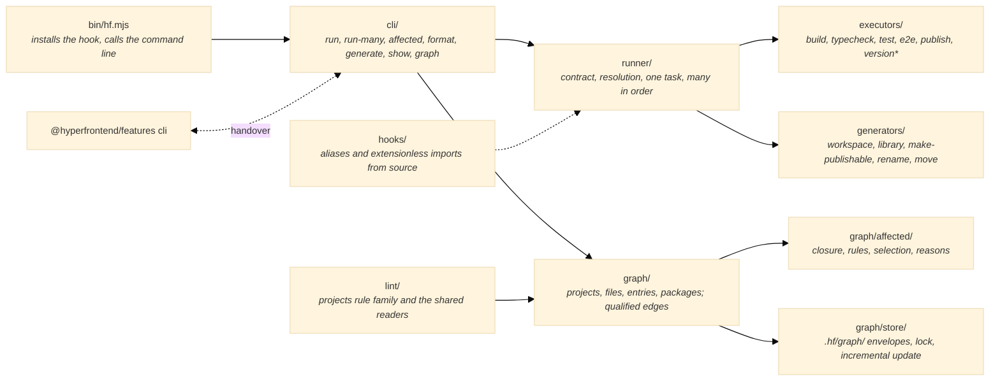
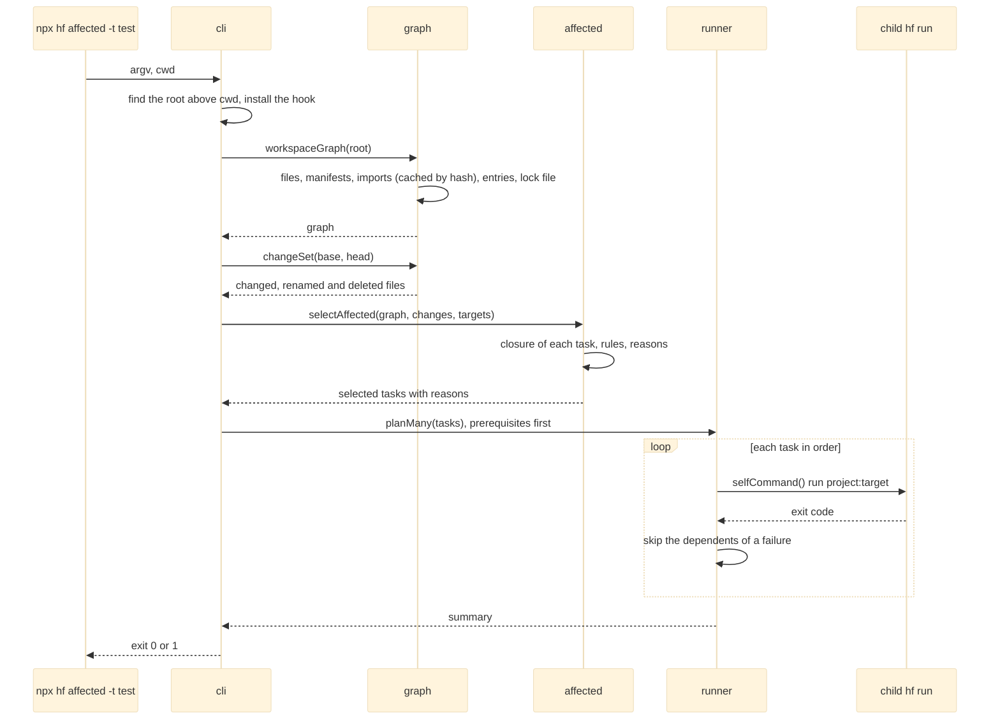

# Architecture

How [`@hyperfrontend/workspace`](https://www.hyperfrontend.dev/docs/libraries/workspace/) is put together: one graph of what reaches what, built once and persisted deterministically; an engine that runs a task exactly as configured; and executors, generators and lint rules loaded by name from manifests, a workspace's own before the packaged ones.

## System Overview



The bin installs the resolution hook and calls the command line. The command line finds the workspace root, builds the graph once per process, and either runs one task in place through the runner or selects tasks through the affected analysis and runs them as children of itself. An executor or generator is a module a manifest names, resolved from the workspace's own projects first and from the installed packages second, and called in the same process. The lint entry reads the same graph for its rules.

## Design Principles

1. **Every edge is qualified, and what cannot be followed is counted whole.** A record carries its kind, the role of the file that drew it, what it resolved to and its evidence, so the analysis can say that a spec's import reaches the test target and not the build. Where the graph cannot name what a file loads, the whole project is reached, and the reason says so.

   ```ts
   // ✅ a decision that names its rule and its evidence
   const decision: TaskDecision = {
     task: 'lib-a:test',
     reasons: [
       {
         rule: 'reachable-from-entry',
         file: 'libs/b/src/index.ts',
         path: ['lib-b', 'lib-a'],
         message: 'lib-a reaches libs/b/src/index.ts through @acme/b',
       },
     ],
   }
   // ❌ a verdict with nothing behind it
   const verdict = { task: 'lib-a:test', selected: true }
   ```

2. **A task runs exactly as configured.** The target of the project merges with the defaults of `hf.json` and runs; nothing it depends on runs first unless the many-task plan was asked for, and nothing is cached, so a laptop and CI see the same run.

   ```ts
   // ✅ the one task, in place
   await runTask({ root, projectName: 'lib-a', targetName: 'test', overrides })
   // ❌ a run that consults a cache before deciding to run
   if (cache.has(hash)) return cache.restore(hash)
   ```

3. **Resolution by name, local first.** An executor id is `<package>:<name>`; a generator name is bare. The workspace project whose manifest carries the package name wins over the installed package, and two local offers of one bare name are refused rather than guessed between.

   ```ts
   // ✅ the manifest decides where the module is
   const { implementation } = executorsManifest(packageDir).executors[name]
   // ❌ a registry the package has to be told about
   registerExecutor('@acme/local:hello', hello)
   ```

4. **Persisted state is a pure function of the checkout.** The graph store writes canonical JSON envelopes whose digests depend on the files' git blob ids, never on modification times or platform paths, so two checkouts of the same commit write the same bytes and CI can verify a cold rebuild byte for byte.

   ```ts
   // ✅ identity from content
   const digest = sha256(canonicalJson(body))
   // ❌ identity from the clock
   const stamp = statSync(file).mtimeMs
   ```

5. **The command line is a function.** The bin is a thin caller; the features package calls the same function when it hands a command over, and the package's e2e suite runs it as an installed process.

## Module Composition

| Module                | Responsibility                                                                                                                              |
| --------------------- | ------------------------------------------------------------------------------------------------------------------------------------------- |
| `src/bin/hf.ts`       | The executable the build bundles: parses nothing, calls the command line                                                                    |
| `src/cli/`            | The commands, their arguments and usage; the handover to the features command line; the graph commands                                      |
| `src/runner/`         | The contract types; resolution of executors, generators and the packages that provide them; one task; many tasks in order; the affected run |
| `src/graph/`          | Discovery of projects and files; imports and their cache; entries; the lock file's packages; roles; the graph and its canonical order       |
| `src/graph/affected/` | The closure of a task, the rules that select it, the selection and its explanation                                                          |
| `src/graph/store/`    | The persisted state: files, imports, graph, entries, meta; the lock; the incremental update plan; verification                              |
| `src/hooks/`          | The resolution hook: aliases from `tsconfig.base.json`, extensionless relative imports, installed on import                                 |
| `src/executors/`      | Build, typecheck, test, e2e, publish, version, version-batch and version-check, each an entry with its schema                               |
| `src/generators/`     | The five generators, each an entry with its schema and templates, and the tree helpers a local generator composes                           |
| `src/lint/`           | The projects rule family and the readers a workspace's own rules share with it                                                              |

## Data Flow

The affected run, which every other command is a subset of:



A single task takes the shorter path: the command line builds the executor context from the discovered projects, merges the target with the defaults, resolves the executor through its manifest, and calls it in the same process. A generator run is the same with a tree in place of the context; the tree records every change and writes them once the generator returns, or prints them under a dry run.

## Core Interfaces

```ts
type Executor<Options> = (options: Options, context: ExecutorContext) => Promise<ExecutorResult> | ExecutorResult

interface ExecutorContext {
  root: string
  cwd: string
  projectName: string
  targetName: string
  target: TargetConfiguration
  projects: Record<string, ProjectConfiguration>
  configuration: WorkspaceConfiguration
}

type Generator<Options> = (tree: Tree, options: Options) => unknown

interface Tree {
  readonly root: string
  read(path: string, encoding: 'utf-8'): string | null
  write(path: string, content: Buffer | string): void
  exists(path: string): boolean
  delete(path: string): void
  children(path: string): string[]
  listChanges(): TreeChange[]
}

interface Reason {
  readonly rule: ReasonRule
  readonly file: string | null
  readonly path: readonly string[]
  readonly message: string
}

interface AffectedSet {
  readonly target: string
  readonly selected: readonly TaskDecision[]
  readonly skipped: readonly TaskDecision[]
  readonly fallbacks: readonly Reason[]
}
```

The contract types are exported from the package root and from the runner entry; the graph's own types ([`WorkspaceGraph`](https://www.hyperfrontend.dev/docs/libraries/workspace/graph/#api-WorkspaceGraph), [`AffectedSet`](https://www.hyperfrontend.dev/docs/libraries/workspace/graph/#api-AffectedSet), [`Reason`](https://www.hyperfrontend.dev/docs/libraries/workspace/graph/#api-Reason)) from the graph entry.

## Links

- [README](./README.md): what the package is for, installation, the commands and the entries.
- [cli](./src/cli/README.md), [runner](./src/runner/README.md), [graph](./src/graph/README.md), [hooks](./src/hooks/README.md), [lint](./src/lint/README.md), [generators](./src/generators/README.md): one page per entry.
