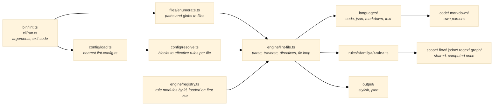
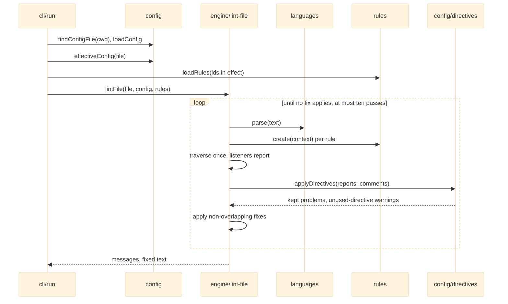

# Architecture

How the workspace linter is put together: one process per Nx `lint` target, one parse per file, every rule's listeners run in a single traversal, and services computed once and shared.

## System Overview



The command finds its configuration, enumerates the files, and lints them one at a time. For each file the engine picks the language by extension, parses once, loads the rules in effect for that file, and runs all of their listeners in one walk of the tree. It then drops what the directives suppress, applies fixes and lints again until no fix applies (at most ten passes), and prints. Nothing is shared between processes except the project graph's import cache on disk.

## Design Principles

1. **Behaviour is the specification.** A rule implements what the workspace configures, and only that: options it never sets do not exist, and message texts, positions and fixes are kept exactly.

   ```ts
   // ✅ the options the workspace sets, nothing else
   const { ignoredDependencies = [], ignoredFiles = [] } = context.options ?? {}
   // ❌ the upstream rule's whole option surface, most of which nothing configures
   const options = { ...UPSTREAM_DEFAULTS, ...context.options }
   ```

2. **One parse, one traversal.** Rules return listeners keyed by node kind; the engine groups them and walks the tree once, so adding a rule adds listeners, not passes.

   ```ts
   // ✅
   create: (context) => ({
     TSEnumDeclaration(node) {
       context.report({ start: node.start, end: node.end, message })
     },
   })
   // ❌ a rule walking the tree itself
   create: (context) => ({
     Program(node) {
       walk(node, visitEverything)
     },
   })
   ```

3. **Services are lazy and shared.** Scope analysis, code paths and the project graph are built on first request and memoised per tree or per process; a rule asks, it never rebuilds.

   ```ts
   // ✅
   const analysis = scopeAnalysisOf(context)
   // ❌
   const analysis = analyseScopes(context.tree)
   ```

4. **Offsets in, positions out.** Rules report offsets; the engine turns them into lines and columns, applies directives by position and orders the messages, so no rule computes a line number.

   ```ts
   // ✅
   context.report({ start: node.start, end: node.end, message })
   // ❌
   context.report({ line: text.slice(0, node.start).split('\n').length, message })
   ```

5. **No external packages, and nothing loaded that a file does not need.** Parsers, the graph and the globals data are the linter's own; a rule module loads only when a block turns it on for a file being linted.

## Module Composition

| Module            | Responsibility                                                                         |
| ----------------- | -------------------------------------------------------------------------------------- |
| `cli/`            | Arguments, the run's flow, exit codes                                                  |
| `config/`         | Loading the nearest `lint.config.ts`, resolving blocks per file, directives            |
| `files/`          | Enumerating files from paths and globs, the glob matcher                               |
| `engine/`         | The rule API, the registry, the per-file lint loop, traversal, fixes, report shapes    |
| `languages/`      | One adapter per language: parse, children table, comments                              |
| `code/`           | TypeScript, TSX and JavaScript scanner and parser, ESTree-shaped                       |
| `markdown/`       | Block and inline Markdown parser, mdast-shaped                                         |
| `text/`           | Line maps and positions                                                                |
| `scope/`          | Scopes, variables, references and their resolution                                     |
| `flow/`           | Code-path segments for the rules that reason about reachability                        |
| `jsdoc/`          | JSDoc blocks, tags and type expressions, and their attachment to nodes                 |
| `regex/`          | Regular-expression patterns and their validity                                         |
| `graph/`          | The project graph Nx would build, with an import cache keyed by file stamp and content |
| `nx/`             | The Nx plugin that infers every project's `lint` target                                |
| `output/`         | Stylish and JSON formatters                                                            |
| `testing/`        | `testRule`, the spec helper every rule's spec uses                                     |
| `rules/<family>/` | One module per rule, shared helpers under `shared/`                                    |

## Data Flow



## Core Interfaces

```ts
/** A rule module's default export. */
interface RuleModule<Options = unknown, Node extends TreeNode = TreeNode> {
  readonly id: string
  readonly language: 'code' | 'json' | 'markdown' | 'text'
  readonly fixable: boolean
  readonly create: (context: RuleContext<Options, Node>) => Listeners<Node>
}

/** What a rule receives. */
interface RuleContext<Options, Node extends TreeNode> {
  readonly file: RuleFile
  readonly tree: Node
  readonly options: Options
  readonly settings: Readonly<Record<string, unknown>>
  readonly language: LanguageSettings
  readonly report: (problem: Problem) => void
}

/** What a rule reports. */
interface Problem {
  readonly start: number
  readonly end?: number
  readonly at?: Location
  readonly message: string
  readonly fix?: { readonly start: number; readonly end: number; readonly text: string }
}

/** One configuration block. */
interface ConfigBlock {
  readonly files?: readonly string[]
  readonly ignores?: readonly string[]
  readonly rules?: Readonly<Record<string, 'off' | 'warn' | 'error' | readonly ['warn' | 'error', unknown]>>
  readonly settings?: Readonly<Record<string, unknown>>
  readonly language?: Partial<LanguageSettings>
}
```

## Links

- [README.md](README.md): running the linter, configuration, layout and commands
- [docs/rules/](docs/rules/): the workspace and project rules
